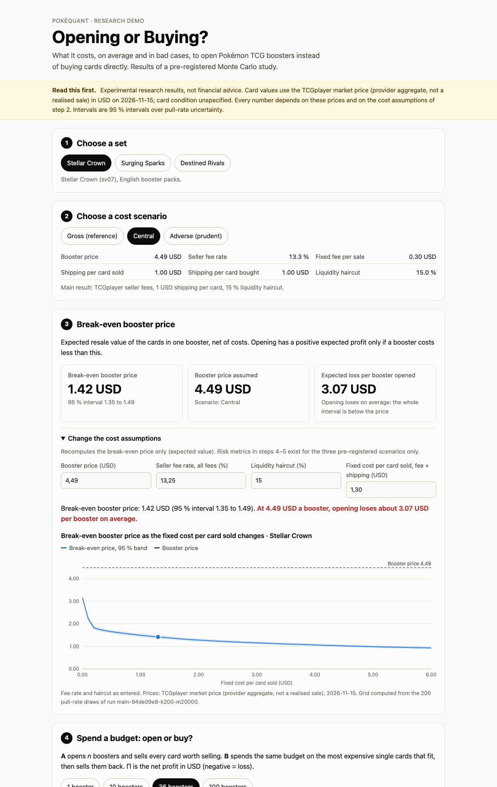

# PokéQuant

[](https://doi.org/10.5281/zenodo.24251050)

**Opening or buying?** A reproducible, probabilistic and risk-adjusted
comparison of Pokémon TCG booster opening versus direct purchase on the
secondary market.

> **Status: working paper, version 2 (November 2026).** Main analysis frozen
> at tag `analysis-v1`; two pre-registered extensions (tags `prereg-v3` and
> `prereg-v4`). Paper in [research/paper/paper.pdf](research/paper/paper.pdf)
> ([HTML](research/paper/paper.html)); interactive demo at
> <https://azekf11.github.io/PokeQuant/>. See the [roadmap](docs/ROADMAP.md).



## Research question

To what extent is opening Pokémon TCG boosters an economically competitive
acquisition strategy compared with buying cards directly on the secondary
market, once pull-rate uncertainty, value dispersion, fees and liquidity are
taken into account?

The project does not try to prove that boosters are or are not profitable. It
measures under which conditions, and with what uncertainty, the strategies
differ, reporting the full distribution (median, probability of loss,
quantiles, CVaR), not only the expected value.

Details: [research protocol](research/protocol/protocol.md) ·
[project charter](docs/PROJECT_CHARTER.md).

## Key results

Three English sets (Stellar Crown, Surging Sparks, Destined Rivals), TCGplayer
market prices in USD on 2026-11-15 (condition unspecified), pull rates from
the Poké Life registry (version 2026-11-13), 200 posterior draws × 20,000
runs. Central cost scenario unless stated.

| Result | Value |
|---|---|
| Break-even booster price (retail 4.49 USD) | 1.03 to 1.42 USD |
| Same, without fees, shipping or haircut | 3.44 to 4.29 USD |
| Mean loss of opening 36 boosters | 111 to 125 USD |
| Mean loss of buying singles with the same budget | 46 to 51 USD |
| Buying decisively better (mean, median, CVaR 5 %) | 35 of 36 budget comparisons |
| Opening until the top card is cheaper than buying it | 4 % to 14 % of runs |
| Robustness variants in which opening still loses on average | 16 of 16 |

Two pre-registered extensions test the same conclusions elsewhere:

| Extension | Result |
|---|---|
| Ten sets: the main three plus every other eligible set that fits the pack layout | Opening loses on average in all ten; central break-even price 0.60 to 2.38 USD; buying wins for every budget of ten boosters or more |
| Cardmarket 30-day average sale prices (EUR, converted at the ECB rate) | Opening still loses on average; central break-even price 1.16 to 2.42 USD |
| Pull rates against their primary source and out of sample | 33 of 33 rates match the published tables; 20 of 20 pooled rows inside the 95 % predictive interval |

Every number has an interval in
[results.md](research/reports/results.md),
[robustness.md](research/reports/robustness.md),
[extension_sets.md](research/reports/extension_sets.md),
[sales_benchmark.md](research/reports/sales_benchmark.md) and
[pull_rate_checks.md](research/reports/pull_rate_checks.md). Answers to the usual
objections: [docs/FAQ.md](docs/FAQ.md).

## Deliverables

1. `pokequant_core`: a Python engine with a slot-based booster model,
   pull-rate uncertainty, nested Monte Carlo simulation, valuation and risk
   metrics.
2. A data ingestion pipeline with a provenance manifest for every source.
3. Reports: [data audit](research/reports/data_audit.md),
   [validation](research/reports/validation.md),
   [valuation](research/reports/valuation.md),
   [simulation diagnostics](research/reports/simulation_diagnostics.md),
   [results](research/reports/results.md),
   [robustness](research/reports/robustness.md),
   [ten sets](research/reports/extension_sets.md),
   [sale prices](research/reports/sales_benchmark.md),
   [pull-rate checks](research/reports/pull_rate_checks.md),
   [QA](research/reports/qa.md).
4. The [working paper](research/paper/paper.pdf), whose figures and tables all
   regenerate from this repository.
5. A [static web demo](https://azekf11.github.io/PokeQuant/) of the frozen
   results (`apps/web/`).

## Repository layout

```
packages/pokequant_core/   Python engine (importable package)
tests/                     Automated tests (+ synthetic toy data in tests/fixtures/)
scripts/                   Reproducible audit and research scripts
data/                      raw/ (immutable snapshots) · processed/ · manifests/ (data provenance)
research/protocol/         Research protocol, booster model specification
research/experiments/      Pre-registered experiment configurations
research/reports/          Data audit and other reports
research/paper/            Paper sources (drafts/), figures and built paper (md, html, pdf)
apps/web/                  Static web demo and its browser tests
docs/                      Roadmap, project charter, decision log (ADRs)
```

## Getting started

Requires [uv](https://docs.astral.sh/uv/).

```bash
git clone https://github.com/Azekf11/PokeQuant.git
cd PokeQuant
uv sync                 # create the environment from uv.lock
uv run pre-commit install
make check              # lint + format check + types + tests
```

Build the processed tables (Parquet + DuckDB views, in the git-ignored
`data/processed/`) from the committed pull-rate snapshot and a local TCGdex
cache; drop `--offline` to fetch missing raw files politely:

```bash
uv run pokequant ingest --pokelife 2026-11-13 --tcgdex 2026-11-15 --sets sv07,sv08,sv10 --offline
```

Each run writes a `manifest.json` with input and output checksums; two runs on
the same inputs give byte-identical outputs.

Regenerate every report, figure and the paper (several hours on eight
cores; `make paper` then prints the PDF):

```bash
make reproduce
```

## Contributing and citation

See [CONTRIBUTING.md](CONTRIBUTING.md) for the workflow and
[CITATION.cff](CITATION.cff) to cite the work. Archived on Zenodo:
[10.5281/zenodo.24251050](https://doi.org/10.5281/zenodo.24251050) (all
versions; v1.1.0, paper version 2, is
[10.5281/zenodo.24265471](https://doi.org/10.5281/zenodo.24265471)).
