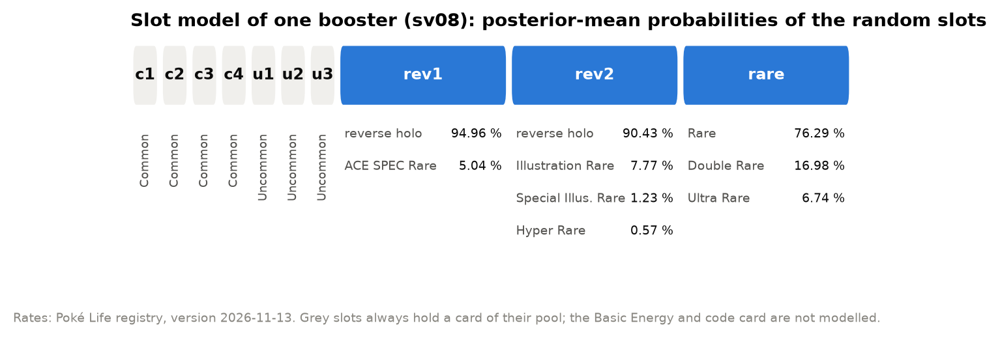
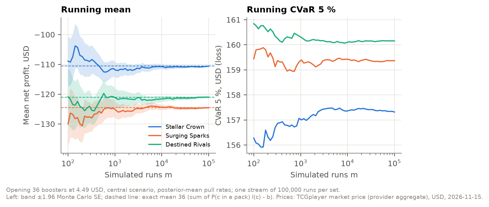
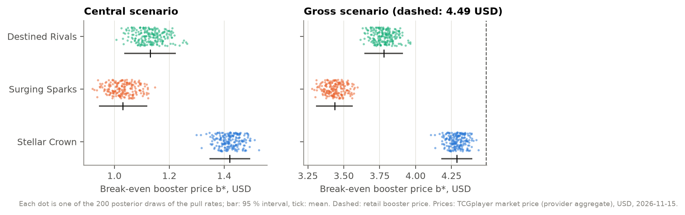

<!-- Version 3. Source of truth: packages/pokequant_core/{model,estimation,booster,simulate,metrics,comparator}.py, research/protocol/model_spec.md, research/reports/validation.md and simulation_diagnostics.md. -->

# 3. Model and simulation

## 3.1 The booster pack

A pack is a sequence of slots s = 1, …, S. Slot s draws a rarity r with
probability π_s(r), then one printing uniformly from the pool P_s(r) of that
rarity, so printing c appears in slot s with probability

q_s(c) = π_s(r(c)) / |P_s(r(c))|.  (2)

The modelled pack has ten slots: four Commons and three Uncommons, which are
fixed, and three random slots taken from the TCGplayer pull-rate articles.
The first reverse-holo slot can hold an ACE SPEC Rare; the second an
Illustration Rare, a Special Illustration Rare or a Hyper Rare; and the rare
slot a Rare, a Double Rare or an Ultra Rare (Figure 1). The Basic Energy and
the code card have no value. Slots are independent and printings equally
likely within a pool. Robustness tests move the Hyper Rare to the rare slot
(R12) and add a documented short print (R11).



## 3.2 Uncertainty on the pull rates

For a random slot whose k hit rarities were observed x_1, …, x_k times in n
packs, the posterior of the slot probabilities under a Jeffreys prior is

(π_s(r_1), …, π_s(r_k), π_s(rest)) ~ Dirichlet(x_1 + ½, …, x_k + ½, n − Σ x_i + ½).  (3)

When the rows of one slot rest on different numbers of packs, each rate is
converted to pseudo-counts on the smallest of them, which never overstates
the information. The posterior reproduces the registry's own Jeffreys
intervals.

## 3.3 Strategies and profit

With liquidation values ℓ from (1), the profit of opening n packs at price b
is

Π_A = Σ_{i=1}^{10n} ℓ(C_i) − n b,  (4)

where C_i are the cards drawn. In E1, strategy B spends the same budget nb on
the most expensive printings of the set, in decreasing order of a(c), and
sells them back: Π_B = Σ_c [ℓ(c) − a(c)], a deterministic amount. The
budgets are 1, 10, 36 and 100 boosters (36 is one booster box). In E2,
strategy A opens packs until the target c\* appears, sells every other card,
and buys c\* if it has not appeared after n_max = ⌈3 / p_hit(c\*)⌉ packs,
where p_hit(c\*) = 1 − ∏_s (1 − q_s(c\*)). Its profit is Π_A = a(c\*) − K_net,
where K_net is the cost of the packs net of the other cards sold; strategy B
buys the target, so Π_B = 0. The targets are each set's most expensive
printing and its most expensive Special Illustration Rare.

Because (4) is linear, the break-even booster price, at which E[Π_A] = 0, has
a closed form:

b\* = Σ_c P(c in a pack) ℓ(c) = Σ_c Σ_s q_s(c) ℓ(c).  (5)

It does not depend on b, so a reader can compare it with any booster price.

## 3.4 Nested Monte Carlo

The other metrics have no closed form. Algorithm 1 keeps the two sources of
uncertainty apart: the outer loop draws pull rates from (3) (epistemic), the
inner loop draws packs at fixed rates (aleatory).

```text
Algorithm 1. Nested Monte Carlo (seed 20261115, K = 200, M = 20,000)

for k = 1..K:                                   # epistemic loop
    draw π^(k) from the Dirichlet posteriors (3), one per random slot
    compute q_s^(k)(c) by (2) and b*^(k) by (5)
    for m = 1..M:                               # aleatory loop
        E1: for each slot s, draw the counts of each printing in n packs
            from Multinomial(n, q_s^(k)); value them with l; Π_A by (4)
        E2: draw the number of packs K ~ Geometric(p_hit^(k)(c*)),
            capped at n_max; value the other cards; Π_A = a(c*) − K_net
    compute, over the M runs: mean, median, P(Π < 0), quantiles,
        VaR 5 %, CVaR 5 %, and their Monte Carlo standard errors
report, for each metric: its mean and 2.5–97.5 % quantiles over the K draws
compare A and B: "decisive" if one is better in ≥ 90 % of the K draws
```

The multinomial step draws all copies of a slot at once, so a run of n packs
costs the same as one pack; ignoring the distinctness of Commons within a
pack changes the standard deviation of the value of ten packs by about 1 %.
The E2 step is exact under slot independence. CVaR 5 % is minus the mean of
the ⌈0.05 M⌉ = 1,000 worst runs, a consistent estimator of expected shortfall
[@acerbi2002coherence]; Monte Carlo standard errors use 20 batch means. All
random streams derive from one seed (NumPy `SeedSequence`, PCG64), one stream
per draw, and every run writes a manifest with a SHA-256 hash of its results.

**Convergence and validation.** With 100,000 runs of 36 boosters at the
posterior-mean rates, the running mean lies 0.13 to 0.48 standard errors from
the exact mean of (5), whereas after 100 runs it can be more than 5 USD off;
the CVaR settles more slowly, as it rests on the worst 5 % of runs (Figure 2).
For the mean profit of 36 boosters, the standard deviation across posterior
draws (1.45 to 1.81 USD) is about five times the Monte Carlo error within a
draw (0.31 to 0.34 USD), so the reported intervals reflect what is unknown
about the rates, not simulation noise (Figure 3). The engine also passes
exact checks before any price was used (Appendix C).





## 3.5 Pre-registered hypotheses and decision rule

H1: the mean, the median and the CVaR can rank the strategies differently.
H2: a verdict that is decisive at the posterior-mean rates can become
undetermined once rate uncertainty is propagated. H3: fees and liquidity costs
reduce the advantage of opening. H4: the winner differs across sets or price
dates. A strategy is decisively better on a metric if it is better in at
least 90 % of the 200 posterior draws; otherwise the comparison is
undetermined.
