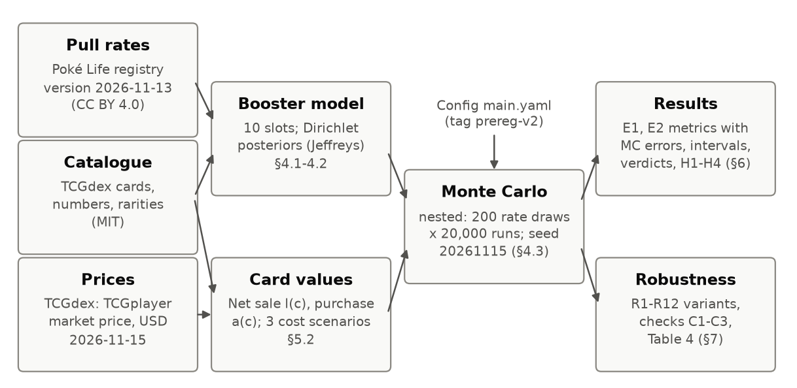
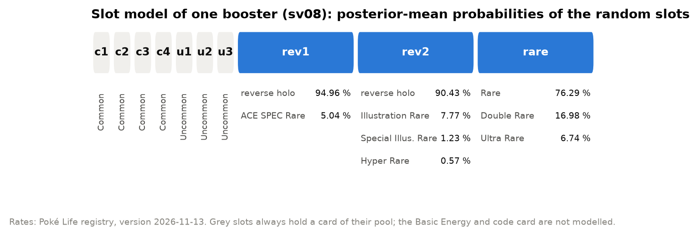

<!-- Draft written in week S5 (amendment A6). Source of truth: packages/pokequant_core/{model,estimation,booster,simulate,metrics,runner}.py and research/protocol/model_spec.md. -->

# 4. Methodology

Figure 1 shows how the data, the model and the simulation produce each
result. Each step is implemented in the repository, and each source box
gives the version or date of its data.

## 4.1 Booster model

A booster is a sequence of slots s = 1, …, S. Each slot draws one rarity
R_s from a categorical distribution, then one printing uniformly from the pool
of that rarity in that slot. The probability that printing c appears in slot s
is

P(C_s = c) = P(R_s = r(c)) / |pool_s(r(c))|,

and, if slots are independent, the probability that one pack contains c is

p_hit(c) = 1 − ∏_s (1 − P(C_s = c)).

The fixed slots (Commons and Uncommons) have a single outcome. Within one pack,
the four Commons are distinct, and so are the three Uncommons (assumption
A-CU); the random slots are drawn with replacement. Assumptions, slot layout
and their sources are listed in §5.1 and in the model specification.

Figure 2 shows the resulting slot structure for Surging Sparks, with the
posterior-mean probability of each outcome of the random slots.

## 4.2 Estimation and uncertainty in the pull rates

For a slot with k mutually exclusive random outcomes observed x_1, …, x_k times
in n packs, the posterior of the slot probabilities is
Dirichlet(x_1 + ½, …, x_k + ½, n − Σx_i + ½) (Jeffreys prior); a single hit
rate has the Beta marginal. When the rows of one slot rest on different
numbers of packs, each rate is converted to pseudo-counts on the smallest
denominator, which never overstates the information. Before two openings are
pooled, homogeneity is tested row by row (χ², Holm–Bonferroni at 5 %).

Uncertainty enters at two levels (protocol §4.3). Epistemic uncertainty is
represented by K draws of all slot probabilities from their posteriors
(K = 200 in the main analysis). Aleatory uncertainty is represented, for each
of these draws, by M simulated openings at fixed probabilities (M = 20 000, so
that 5 % tail metrics rest on at least 1 000 samples). Every metric is
therefore a distribution over epistemic draws, summarised by its posterior
mean and its 2.5 %–97.5 % interval, and each per-draw value carries a Monte
Carlo standard error.

## 4.3 Simulation engine

The model is compiled once into integer arrays (one pool of printing indices
per slot outcome), and we use two sampling paths. The first draws card by
card. For n packs, each slot draws an outcome by inversion of its cumulative
probabilities and a printing uniformly within the pool. Commons and Uncommons
that repeat inside a pack are redrawn until distinct (A-CU). We use this path
for validation and for the pack that contains the target in E2.

The second path works in aggregate. For a run of m packs, the number of copies
of each printing in slot s is multinomial with m trials and probabilities
P(C_s = ·), and the total value is the inner product of these counts with the
card values. This is exact in distribution for slots drawn with replacement,
and it costs O(S × number of printings) per run, independently of m. Ignoring
A-CU in this path changes the standard deviation of the value of ten packs by
about 1 % (validation report, §5).

In experiment E1 (budget), the profit of opening n packs at unit cost b is
Π = Σ_i ℓ(C_i) − n b, where ℓ is the liquidation value of §5.2.

In experiment E2 (target), the number of packs needed for the first copy of
target c\* is K ~ Geometric(p_hit) under slot independence. The engine draws K,
caps it at n_max (the opener then buys c\* at its acquisition price a(c\*)),
values the K − 1 packs without the target with the slot distributions
conditioned on not drawing c\*, and values the hit pack with c\* forced into
its slot and the other slots unconditional. The resulting net cost is

K_net = min(K, n_max) · b − Σ (value of the other cards opened) + 1{K > n_max} a(c\*),

and Π = a(c\*) − K_net. This decomposition is exact under slot independence;
it avoids simulating the hundreds of packs that a Special Illustration Rare
typically requires.

## 4.4 Metrics and Monte Carlo error

For each epistemic draw, the engine reports the mean, median, P(Π < 0), the
5 %, 25 %, 75 % and 95 % quantiles, and VaR and CVaR at 5 % as positive losses
(CVaR is minus the mean of the ⌈αN⌉ smallest values). Monte Carlo standard
errors use 20 batch means. A comparison between strategies is decisive when one
of them is better in at least 90 % of the epistemic draws, and undetermined
otherwise (protocol §7.0b).

## 4.5 Reproducibility

All random streams derive from one seed through NumPy's `SeedSequence.spawn`,
with PCG64 generators: one stream draws the posterior parameters, and each
epistemic draw has its own aleatory stream, so results do not depend on the
order of execution. Each run writes a manifest with the seed, the number of
draws, the model and data snapshot identifiers, the parameters and a SHA-256
hash of the results; identical seed, data and model give an identical hash.

## 4.6 Validation

The engine was checked against closed-form results before any price was used
(`research/reports/validation.md`, generated by `scripts/validate_engine.py`).
In the simplest case, one slot with two cards, the simulated mean and variance
lie within Monte Carlo error of the exact values. We compared per-slot card
frequencies in Surging Sparks with the model probabilities (χ² goodness of
fit, 10⁶ packs; no rejection), and the number of packs containing a given
Special Illustration Rare among 100 with the binomial distribution. For
N = 10³ to 10⁶ packs, the root-mean-square error of the simulated mean has a
fitted log-log slope of −0.52 (theory −0.5). The aggregate and card-by-card
paths show no difference (Kolmogorov–Smirnov). For E2, we compared the mean
number of packs opened and the probability of reaching the cap with the
truncated geometric distribution. Finally, identical seed, data and model
reproduce identical output.
