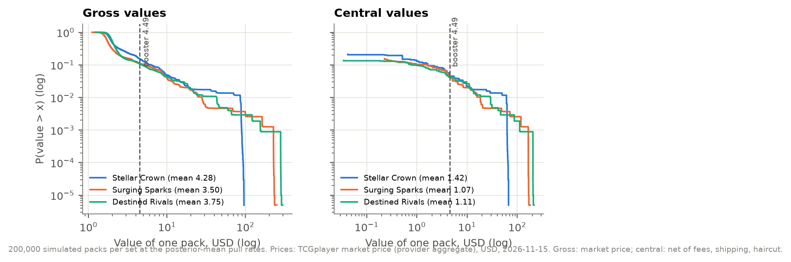
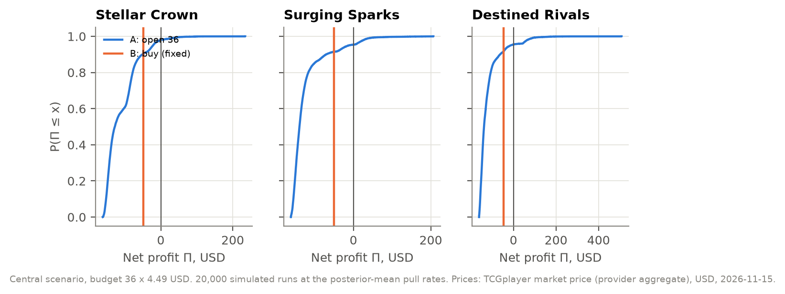
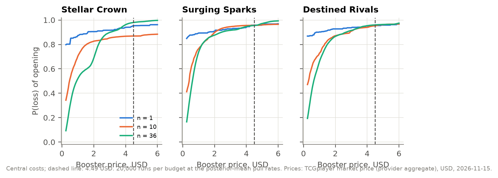

<!-- Version 2. Source of truth: research/reports/results.md (run main-94de09e8-k200-m20000, tag analysis-v1). -->

# 4. Results

All amounts are in USD, conditional on the TCGplayer market prices of
2026-11-15 and on the cost scenarios of Table 2. Brackets give 95 % intervals
over the 200 posterior draws of the pull rates.

## 4.1 The value of a pack

Without any fee, shipping or haircut, the break-even booster price b\* is
4.29 [4.18, 4.39] for Stellar Crown, 3.44 [3.31, 3.56] for Surging Sparks and
3.78 [3.65, 3.91] for Destined Rivals: all below the retail price of 4.49.
Under central costs it falls to 1.42, 1.03 and 1.13, and under adverse costs
to between 0.52 and 0.78. The fall comes from the fixed cost of a sale. In
79 % to 86 % of simulated packs no card is worth more than its selling cost,
so the net value of the pack is zero and the value of opening sits in a thin
tail of rare hits (Figure 4).

## 4.2 Spending a budget (E1)

Under central costs, opening loses money on average for every set and
budget, with every 95 % interval below zero. Table 3 reports the budget of 36
boosters. Opening loses 110.56 to 124.56 on average and more in the median
run, and it loses money in 95.5 % to 98 % of runs. Buying the most expensive
cards the budget allows and selling them back also loses money, through
round-trip fees and shipping, but 46 to 51: less than half as much.

**Table 3.** Budget of 36 boosters (161.64 USD), central scenario.

| | Stellar Crown | Surging Sparks | Destined Rivals |
|---|---|---|---|
| Break-even booster price b\* | 1.42 [1.35, 1.49] | 1.03 [0.95, 1.12] | 1.13 [1.04, 1.22] |
| A, open: mean Π | −110.56 [−113.33, −107.88] | −124.56 [−127.74, −121.32] | −120.97 [−124.35, −117.55] |
| A, open: median Π | −128.39 [−131.93, −124.88] | −139.55 [−140.94, −138.12] | −138.36 [−140.12, −136.25] |
| A, open: P(Π < 0) | 0.980 [0.975, 0.984] | 0.955 [0.946, 0.963] | 0.957 [0.949, 0.966] |
| A, open: CVaR 5 % (loss) | 157.33 [156.86, 157.78] | 159.39 [159.01, 159.71] | 160.15 [159.90, 160.45] |
| B, buy and resell: Π | −48.55 | −50.60 | −46.48 |
| Decisive winner (mean / median / CVaR) | B / B / B | B / B / B | B / B / B |

*Source:* `research/reports/results.md`, which gives every budget and
scenario.

Across all budgets and sets, buying is decisively better on the mean, the
median and the CVaR in 35 of the 36 central comparisons. The exception is the
mean for Stellar Crown at a one-booster budget, which is undetermined: there
the two strategies differ by less than 0.40. Figure 5 shows the whole
distribution for 36 boosters, and Figure 6 the probability of a loss as a
function of the booster price. Even at 2 USD a pack, opening 36 packs loses
money in most runs.

## 4.3 Chasing one card (E2)

The most valuable printings are rare: one pack in 168 [158, 179] for Stellar
Crown's top card, one in 904 [765, 1,072] for Surging Sparks' and one in
1,008 [875, 1,174] for Destined Rivals'. Under central costs, opening until
the target appears is cheaper than buying it in only 4 % to 14 % of runs, and
costs 468 to 3,145 more than buying on average. In the worst 5 % of runs it
costs 1,755 to 10,731 more (CVaR 5 %). Buying is decisively better on all
three metrics for every set and target, in all three cost scenarios, with
one exception: under gross prices, opening for Stellar Crown's top card is
cheaper in 52 % of runs and the median verdict is undetermined.

## 4.4 Hypotheses

H1 is supported, narrowly. Only under adverse costs at a one-booster budget,
for Stellar Crown and Surging Sparks, does the mean favour opening while the
median and the CVaR favour buying: a single direct purchase pays 4.50 of
shipping. Elsewhere the three metrics agree. H2 is supported once: for
Stellar Crown's top card under gross prices, the median favours opening at
the posterior-mean rates but becomes undetermined once rate uncertainty is
propagated. H3 is supported: for every set and every budget of ten boosters
or more, costs reduce the advantage of opening, and in E2 they lower the
probability that opening beats buying by 0.12 to 0.38. H4 is not supported
across the three sets, since buying wins in each.
