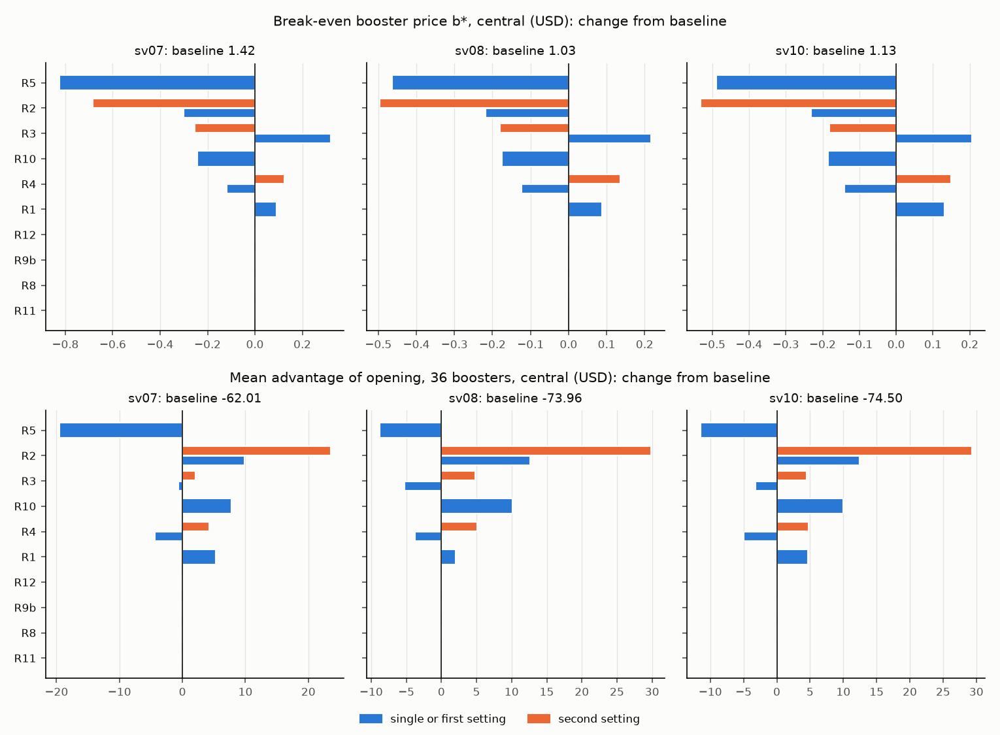
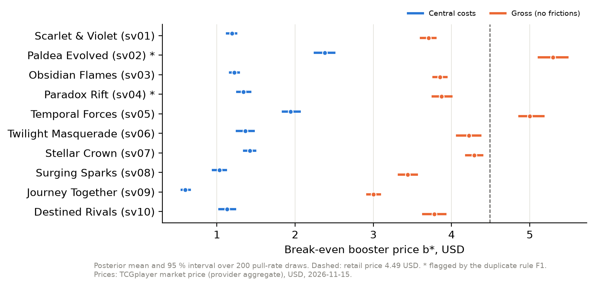

<!-- Version 2. Sources: research/reports/robustness.md (ADR 0012), extension_sets.md (ADR 0015), sales_benchmark.md (ADR 0014), pull_rate_checks.md (ADR 0015). -->

# 5. Robustness and extensions

I check three conclusions, all under central costs. C1: the 95 % interval of
the mean profit of opening is below zero for every set and budget. C2: the
upper 95 % bound of b\* is below 4.49, both central and gross. C3: buying is
decisively better on the mean, the median and the CVaR for every budget of
ten boosters or more and every target.

## 5.1 Pre-registered robustness tests

Each of the sixteen variants changes one assumption and keeps the seed, the
draws and the runs. Variants that change only card values reuse the
simulated openings of the main run, so differences come from the assumption,
not from simulation noise; the baseline reproduces the main run exactly.
Table 4 reports the central b\* and the checks.

**Table 4.** Robustness variants: central break-even price b\* (posterior
mean) and conclusions C1–C3.

| Variant | b\* sv07 | b\* sv08 | b\* sv10 | C1 | C2 | C3 |
|---|---|---|---|---|---|---|
| Baseline | 1.42 | 1.03 | 1.13 | yes | yes | yes |
| R1 median of price statistics | 1.51 | 1.12 | 1.26 | yes | no | yes |
| R2 haircut 0.30 / 0.50 | 1.12 / 0.73 | 0.81 / 0.54 | 0.90 / 0.60 | yes | yes | yes |
| R3 selling costs × 0.5 / × 1.5 | 1.74 / 1.17 | 1.25 / 0.85 | 1.34 / 0.95 | yes | yes | yes |
| R4 rates at lower / upper bounds | 1.30 / 1.54 | 0.91 / 1.17 | 0.99 / 1.28 | yes | yes | yes |
| R5 top 1 % of printings excluded | 0.59 | 0.57 | 0.64 | yes | yes | yes |
| R7 1,000 / 10,000 / 100,000 runs | 1.42 | 1.03 | 1.13 | yes | yes | yes |
| R8 uniform prior | 1.42 | 1.03 | 1.13 | yes | yes | yes |
| R9b half effective sample size | 1.42 | 1.03 | 1.13 | yes | yes | yes |
| R10 haircut 0.27 (Heck et al.) | 1.18 | 0.86 | 0.95 | yes | yes | yes |
| R11 short-printed Double Rare | 1.42 | n/a | n/a | yes | yes | yes |
| R12 Hyper Rare in the rare slot | 1.42 | 1.03 | 1.13 | yes | yes | yes |

*Source:* `research/reports/robustness.md`, with intervals and the change in
the gap at 36 boosters. Paired variants (R2, R3, R4, R7) pass every check in
both settings.

C1 and C3 hold in every variant. C2 fails once: when cards are valued at the
median of TCGplayer's listing and market statistics (R1), the gross b\* of
Stellar Crown has a posterior mean of 4.42 but an upper bound of 4.53. Across
all variants the central b\* stays between 0.54 and 1.74, at most 39 % of the
retail price.

Figure 7 shows what moves the results. Liquidation assumptions set the size
of the gap: a haircut of 0.50 roughly halves b\*, and excluding the 1 % most
valuable printings lowers it by 0.46 to 0.83. Pull-rate assumptions barely
matter: the prior, the effective sample size and the slot of the Hyper Rare
leave b\* unchanged at two decimals, and even setting every rate at a bound
of its interval at once moves it by at most 0.15. With fewer runs per draw,
only comparisons at a one-booster budget change verdict, where the
strategies differ by less than 0.40. H2 depends on such a comparison, so I
report it as supported but fragile.

## 5.2 Ten sets

ADR 0015 (tag `prereg-v4`) extends the main experiment to every eligible set
that fits the main pack layout. Seven of the twelve other eligible sets do:
Scarlet & Violet, Paldea Evolved, Obsidian Flames, Paradox Rift, Temporal
Forces, Twilight Masquerade and Journey Together. The four Mega Evolution sets
have a "Mega Hyper Rare" with no slot in the layout, and 30th Celebration has
rarities absent from the catalogue; no layout was invented for them. The run
uses the configuration, seed and price snapshot of the main run. Random
streams are keyed by a set's position in the configuration, so the three main
sets are re-simulated with new streams; their central and gross b\* are
identical to two decimals.

C1 and C3 hold in all ten sets. Opening loses on average for every budget,
and buying is decisively better on the mean, the median and the CVaR for
every budget of ten boosters or more and every target. The central b\* ranges
from 0.60 (Journey Together) to 2.38 (Paldea Evolved) (Figure 8). C2 fails for
two sets, whose gross b\* exceeds the retail price: 5.29 [5.12, 5.48] for
Paldea Evolved and 5.00 [4.87, 5.18] for Temporal Forces. For these sets a
pack's expected market value is above its price, and the loss from opening
comes entirely from selling costs. Without frictions, opening one or ten of
their boosters has a positive mean but loses money in more than half of the
runs, a clear case of H1.

H4 across sets is now supported, but only at a one-booster budget. There,
opening has the higher mean for Paldea Evolved, Temporal Forces and Stellar
Crown, by 0.08 to 1.07 USD, and buying for five other sets. For every budget
of ten boosters or more and every target, buying wins in all ten sets. Stellar
Crown's one-booster verdict, undetermined in the main run (opening better in
89.5 % of draws), becomes decisive here (92 %) with different random streams:
it is the near tie noted in Section 5.1. Every hypothesis keeps its status
when the two flagged sets are removed. Full results are in
`research/reports/extension_sets.md`.

## 5.3 Sale prices

The TCGplayer market price is a provider aggregate, not an observed sale. As a
check, I revalued every card at Cardmarket's 30-day average sale price
(`avg30`), which the venue's API documentation defines as the average sale
price over the last 30 days, relayed by TCGdex for 2026-11-15 and converted
at the European Central Bank reference rate of 1.1052 USD per EUR
(2026-11-13). The exact b\* of (5) was recomputed in each posterior draw.
This extension was pre-registered before the values were analysed (ADR 0014,
tag `prereg-v3`).

**Table 5.** Break-even booster price b\* valued at Cardmarket sale prices,
2026-11-15 (USD).

| | Stellar Crown | Surging Sparks | Destined Rivals |
|---|---|---|---|
| Central, TCGplayer market price | 1.42 [1.35, 1.49] | 1.03 [0.95, 1.12] | 1.13 [1.04, 1.22] |
| Central, Cardmarket 30-day sales | 1.16 [1.10, 1.21] | 2.42 [2.32, 2.53] | 1.71 [1.55, 1.86] |
| Gross, Cardmarket 30-day sales | 2.89 [2.80, 2.98] | 4.75 [4.61, 4.91] | 3.46 [3.25, 3.68] |

*Source:* `research/reports/sales_benchmark.md`. Hit-printing coverage 100 %.

C1 holds in every set: under central costs, opening still loses on average
at sale prices. C2 fails for Surging Sparks, whose gross b\* of 4.75 exceeds
4.49; without any friction, its pack would be worth more than its price at
European sale prices. Over hit printings, the median ratio of the Cardmarket
sale average to the TCGplayer market price is 0.94 [0.87, 1.03] for Stellar
Crown and 1.22 [1.14, 1.31] and 1.23 [1.16, 1.33] for the two other sets
(bootstrap intervals, 49 to 87 printings). The haircut assumed in the central
scenario is therefore not visible in this comparison, although it mixes two
markets and two price types. A weekly panel of the same statistics until
2027-01-10 will test the date half of H4.

## 5.4 Pull-rate checks

Three checks were pre-registered for the pull rates (ADR 0015, tag
`prereg-v4`). First, the registry was compared with its primary source: for
the seven added sets, all 33 single-source rows equal the rate printed in the
TCGplayer article to two decimals. Second, a duplicate check found that the
Paradox Rift and Paldea Evolved articles print the same Ultra Rare
(6.64 % ± 0.53 %) and Illustration Rare (7.70 % ± 0.56 %) rates. Two
independent samples rarely agree this closely on two rarities, so both sets
are flagged; Section 5.2 shows that removing them changes no conclusion. Third,
in a held-out test, a Jeffreys posterior on the TCGplayer counts alone
predicts the hits of the second opening in its own packs. In all 20 pooled
rows the observed hits fall inside the 95 % beta-binomial predictive
interval, and the smallest two-sided p-value is 0.161, so no row is rejected
after Holm correction. Pooling the two openings, as the main analysis does,
is consistent with the data.
