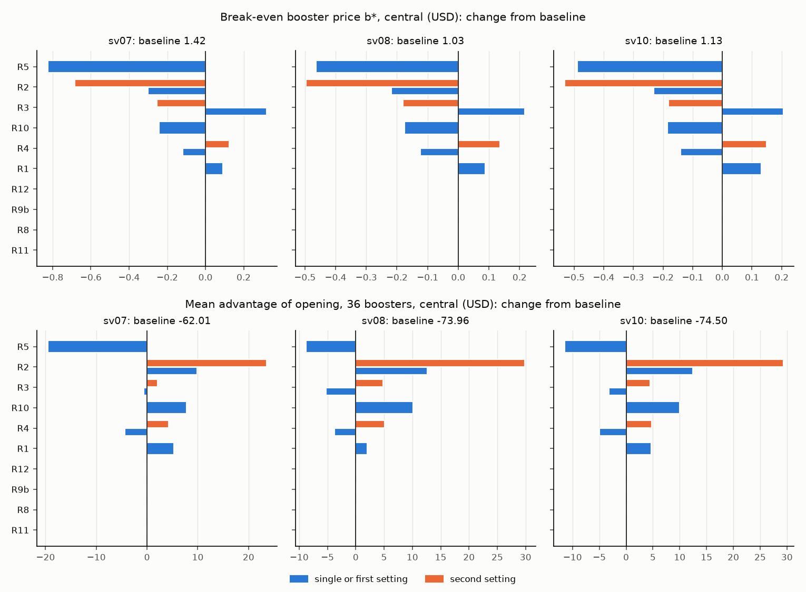
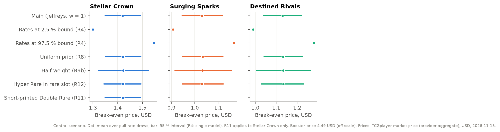

<!-- Draft written in week S8. Source of truth: research/reports/robustness.md (run main-94de09e8-k200-m20000, robustness variants). Test definitions: ADR 0012. -->

# 7. Robustness

The robustness tests were registered at `prereg-v2` and defined
operationally before any of them was run (ADR 0012). Each test changes one
assumption of the main run. It keeps the seed, the 200 pull-rate draws and
the 20,000 runs per draw. Variants that change only card values are valued
on the same simulated openings as the main run (common random numbers): any
difference is due to the assumption, not to simulation noise. As a check, the
baseline of these variants reproduces the main run exactly (largest
difference 0.00 USD).

We check three conclusions in each variant:

- **C1. Opening loses on average.** The 95 % interval of the mean profit of
  opening is below zero, for every set and budget.
- **C2. The break-even price is below the booster price.** The upper 95 %
  bound of the break-even booster price is below 4.49 USD, central and gross.
- **C3. Buying is decisively better.** It wins on the mean, the median and the
  CVaR 5 %, for every budget of 10 boosters or more and every target.

All three use the central scenario.

## 7.1 Results

Table 4 summarises the 16 variants and the baseline:

- **C1 and C3 hold in all 17 rows.**
- **C2 holds in 16.** It fails once, for the gross break-even price of
  Stellar Crown when cards are valued at the median of TCGplayer's listing
  and market statistics (R1). There the posterior mean is still below the
  booster price (4.42 USD), but the upper bound is 4.53 USD. The central
  break-even price of the same variant is 1.51 [1.44, 1.59] USD.

The central break-even booster price ranges from 0.54 to 1.74 USD over all
variants and sets, never more than 39 % of the retail price.

**Table 4.** Central break-even booster price b* (USD, posterior mean),
change in the mean advantage of opening over buying at 36 boosters relative
to the baseline (Δ, USD), and checks C1–C3.

| Variant | b* sv07 | b* sv08 | b* sv10 | Δ sv07 | Δ sv08 | Δ sv10 | C1 | C2 | C3 |
|---|---|---|---|---|---|---|---|---|---|
| Baseline | 1.42 | 1.03 | 1.13 | (−62.0) | (−74.0) | (−74.5) | yes | yes | yes |
| R1 median of statistics (indicative) | 1.51 | 1.12 | 1.26 | +5.3 | +2.1 | +4.7 | yes | **no** | yes |
| R2 haircut 0.30 | 1.12 | 0.81 | 0.90 | +9.8 | +12.7 | +12.4 | yes | yes | yes |
| R2 haircut 0.50 | 0.73 | 0.54 | 0.60 | +23.5 | +29.9 | +29.3 | yes | yes | yes |
| R3 selling costs × 0.5 | 1.74 | 1.25 | 1.34 | −0.6 | −5.2 | −3.2 | yes | yes | yes |
| R3 selling costs × 1.5 | 1.17 | 0.85 | 0.95 | +2.0 | +4.8 | +4.5 | yes | yes | yes |
| R4 rates at lower bounds | 1.30 | 0.91 | 0.99 | −4.4 | −3.7 | −4.9 | yes | yes | yes |
| R4 rates at upper bounds | 1.54 | 1.17 | 1.28 | +4.2 | +5.1 | +4.8 | yes | yes | yes |
| R5 top 1 % excluded (E1) | 0.59 | 0.57 | 0.64 | −19.6 | −8.7 | −11.5 | yes | yes | yes |
| R7 1,000 runs | 1.42 | 1.03 | 1.13 | +0.1 | −0.1 | −0.1 | yes | yes | yes |
| R7 10,000 runs | 1.42 | 1.03 | 1.13 | 0.0 | +0.1 | 0.0 | yes | yes | yes |
| R7 100,000 runs | 1.42 | 1.03 | 1.13 | 0.0 | +0.1 | 0.0 | yes | yes | yes |
| R8 uniform prior | 1.42 | 1.03 | 1.13 | 0.0 | +0.1 | +0.1 | yes | yes | yes |
| R9b half sample size | 1.42 | 1.03 | 1.13 | +0.1 | +0.2 | +0.1 | yes | yes | yes |
| R10 haircut 0.27 (transferred) | 1.18 | 0.86 | 0.95 | +7.8 | +10.2 | +10.0 | yes | yes | yes |
| R11 short print (sv07) | 1.42 | n/a | n/a | 0.0 | n/a | n/a | yes | yes | yes |
| R12 Hyper Rare in rare slot | 1.42 | 1.03 | 1.13 | +0.1 | +0.1 | +0.1 | yes | yes | yes |

The complete table, with intervals, is in `research/reports/robustness.md`.

## 7.2 What moves the results

**Liquidation assumptions dominate.**

- **Haircut.** Doubling the liquidity haircut from 0.15 to 0.30 lowers the
  break-even price by about a fifth (R2). A haircut of 0.50 roughly halves it.
- **Haircut anchored on sell-through.** The haircut of 0.27 derived from the
  sell-through rates of Heck et al. (R10) gives results between the central
  and the doubled haircut.
- **Selling and shipping costs.** Halving them raises the break-even price by
  about 0.2 to 0.3 USD (R3).

Higher costs also narrow the gap between the strategies. They hurt buying
too, because the buyer resells its cards: with a 50 % haircut, the gap at 36
boosters shrinks by about 24 to 30 USD. The gap stays above 38 USD in every
variant.

**Excluding the most valuable cards matters as much as the largest
haircut.** Removing the 1 % most valuable printings of each set (R5) lowers
the central break-even price by 0.46 to 0.83 USD and widens the gap at 36
boosters by 9 to 20 USD. Much of the value of opening sits in a few cards.
The conclusions hold with or without them.

**The pull-rate assumptions barely matter.** None of the following changes
the central break-even price, at two decimals, or the gap by more than
0.2 USD:

- the prior (R8);
- halving the effective sample size (R9b), which widens the intervals;
- the slot of Hyper Rares (R12);
- the documented short print (R11).

Setting every hit rate at a bound of its 95 % interval at once (R4), an
extreme case, moves the central break-even price by 0.12 to 0.15 USD. This
is comparable to the width of the intervals of the main run. Figure 6 shows
these pull-rate variants set by set.

## 7.3 Simulation precision (R7)

With 1,000, 10,000 or 100,000 runs per draw instead of 20,000, every metric
stays within its uncertainty interval. Three verdicts change, all at a
one-booster budget, where the two strategies differ by less than 0.40 USD:

- **Stellar Crown, mean.** Undetermined in the main run: opening beats
  buying in 89.5 % of the draws, just under the 90 % threshold. It becomes
  decisive for opening with 100,000 runs (97.5 %). The posterior share in the
  main run is diluted by within-draw simulation noise. With more runs per
  draw, the advantage of opening on the mean at one booster, 0.09 USD, is
  resolved.
- **Surging Sparks and Destined Rivals, mean.** They become undetermined with
  1,000 runs. These are the only verdicts that change with the number of runs.

None of the three is part of C1–C3.

**Implication for H2.** Hypothesis H2 asks whether a verdict that is decisive
at the posterior-mean rates becomes undetermined once their uncertainty is
propagated. Its status depends on the precision of the simulation:

- with 1,000 runs per draw, it is no longer supported;
- with 10,000 runs, it has a second instance (Stellar Crown, one booster,
  mean).

Both instances are comparisons near a tie. We therefore report H2 as
supported, but fragile.

## 7.4 Status of the hypotheses

H1, H2 and H3 keep their status in every variant except the one above (R7
with 1,000 runs, H2). They are not evaluated under R4, which has no
posterior draws. H4 is tested across the three sets (R6) and is not
supported: buying wins in every set. Its second half, across price dates,
awaits the second snapshot. R13 was not run, as registered: the homogeneity
test did not reject pooling.

## 7.5 Gate G8

The protocol (§10) sets six publishability criteria for the analysis freeze.

| Criterion | Assessment | Status |
|---|---|---|
| Question | Precise and falsifiable: four pre-registered hypotheses with decision rules. H4 is not supported across sets, and H2 is supported but fragile. | GO |
| Data | Traceable: dated snapshots, checksums and manifests. Legally usable: CC BY 4.0 rates; prices used with permission, only derived statistics published (ADR 0009). Comparable: one price type, one date, one currency. Limit: a provider aggregate, not realised sales. | GO, with stated limit |
| Method | Explicit slot model (model specification). The engine is validated against exact results (Appendix C). | GO |
| Results | C1 and C3 hold in every variant. C2 fails only for one set's gross break-even price under indicative asking prices. No conclusion hinges on one rate or one price. | GO, with stated limit |
| Novelty | Positioned against the literature and practitioner tools (§2). The closest work was read in full; most others at abstract level. | GO |
| Reproducibility | One command regenerates every table and figure from frozen configurations and seeds. The baseline of the robustness run reproduces the main run exactly. The validation, valuation and results reports regenerate byte for byte. | GO |

The gate is passed. The analysis is frozen at tag `analysis-v1`. Later
changes to the analysis require an ADR and are reported as deviations.
