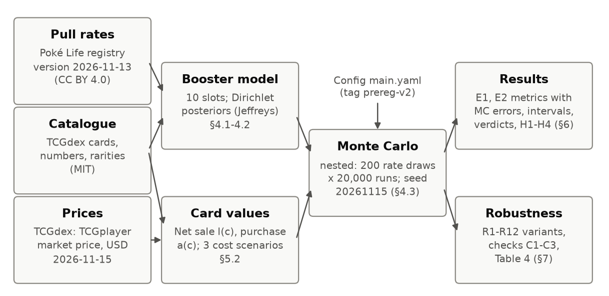
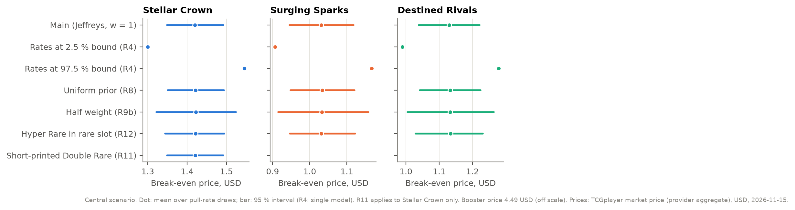
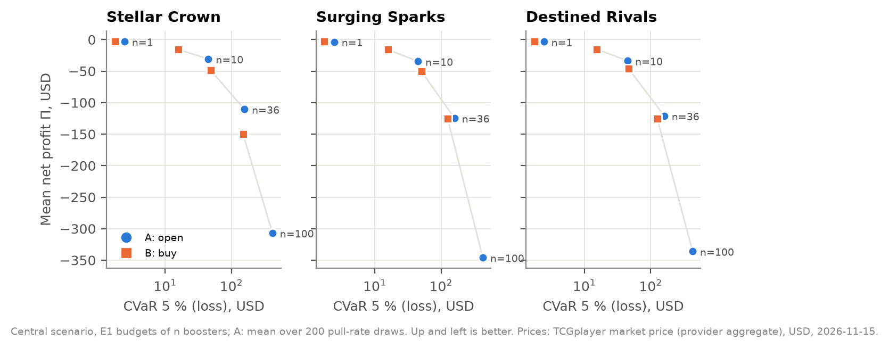

<!-- Version 2. Sources of truth: data/manifests/, research/experiments/*.yaml, research/reports/validation.md, docs/decisions/. -->

# Appendix

## A. Sources of every input

**Table A1.** Inputs, sources and status in the replication package.

| Input | Value(s) used | Source and date | Licence or permission | In the package |
|---|---|---|---|---|
| Pull rates | Hits, packs, rates of every hit rarity | Poké Life pull-rate evidence registry, version 2026-11-13 | CC BY 4.0 | Yes, with SHA-256 checksums |
| Primary pull-rate tables | Printed rates and margins, fourteen sets | TCGplayer pull-rate articles, read 2026-11-15 (ten sets) and 2026-11-16 (four Mega Evolution sets) | Facts cited with URLs | `research/reports/*tcgplayer_published_rates.csv` |
| Slot layout | Positions of hit rarities | TCGplayer pull-rate articles; model specification | Facts cited | Described |
| Catalogue | Cards, numbers, rarities, variants | TCGdex API, 2026-11-15 | MIT | Re-fetched by script |
| Prices (main) | TCGplayer market price, USD | TCGdex relay, provider time 2026-11-14 22:22–22:24 UTC | Permission for this non-commercial project (ADR 0009) | No; derived statistics and checksums only |
| Prices (check) | Cardmarket 30-day average sale price, EUR | TCGdex relay, 2026-11-15; definition from the Cardmarket API 2.0 documentation | Same as above | No; derived statistics only |
| Exchange rate | 1.1052 USD per EUR | ECB, series EXR.D.USD.EUR.SP00.A, 2026-11-13 | Public statistics | Cached request URL |
| Seller fees | 10.75 %, 2.5 % + 0.30 USD | TCGplayer seller fee page, read 2026-11-15 | Facts cited | `research/experiments/main.yaml` |
| Booster price | 4.49 USD (5.49 adverse) | Assumption: US retail price at launch; no official price list | n/a | Configuration |
| Shipping, haircut | 1.00 / 4.50 USD; 0.15 / 0.30 | Assumptions; R10 anchors the haircut on Heck et al. [-@heck2026sales] | n/a | Configuration |

Every price observation carries its date, currency, condition (unspecified)
and type (provider market aggregate or venue sale average). No listing price
is used as a transaction value, and missing prices are never set to zero
except in the adverse scenario, where this is stated.

## B. Definitions

| Metric | Definition |
|---|---|
| Mean, median | E[Π], q₀.₅(Π) |
| P(loss) | P(Π < 0) |
| VaR 5 % | −q₀.₀₅(Π), a positive loss |
| CVaR 5 % | −E[Π \| Π ≤ q₀.₀₅(Π)]; estimator: minus the mean of the ⌈0.05 M⌉ smallest of M runs |
| Break-even price b\* | Equation (5); E[Π_A] = n(b\* − b) in E1 |
| P(K < a(c\*)) | Share of runs in which opening until the target was cheaper than buying it |
| Interval | 2.5 % and 97.5 % quantiles over the 200 posterior draws |
| Monte Carlo error | Batch-means standard error (20 batches) within a draw, median over draws |
| Decisive | One strategy better in at least 90 % of the posterior draws |

## C. Validation of the engine

`scripts/validate_engine.py` checks the engine against exact results with
synthetic card values, before any price was used:

1. A one-slot toy case gives a simulated mean 1.76 standard errors from the
   exact value with N = 10⁶.
2. Simulated card frequencies in the three random slots of Surging Sparks
   pass a χ² test (p = 0.15, 0.64 and 0.54).
3. Hit counts of a Special Illustration Rare over 100 packs match the
   binomial distribution in mean, variance and P(at least one).
4. The root-mean-square error of the mean falls with a log-log slope of
   −0.52 (theory −0.5) from N = 10³ to 10⁶.
5. The multinomial and card-by-card samplers agree (Kolmogorov–Smirnov
   p = 0.91).
6. The capped number of packs to a target matches its closed form.
7. The same seed, data and model give identical output.

The full report is `research/reports/validation.md`. The exact b\* of
equation (5) also matches the break-even price computed by the engine within
a relative tolerance of 10⁻⁶ in the test suite (synthetic data).

## D. Simulation parameters

**Table A2.** Parameters of the main run.

| Parameter | Value |
|---|---|
| Sets | Stellar Crown (sv07), Surging Sparks (sv08), Destined Rivals (sv10) |
| Product | One English booster; 10 modelled slots (layout `tcgplayer`) |
| Prior | Jeffreys (a₀ = ½), weight 1 on every registry row |
| Epistemic draws K | 200 |
| Aleatory runs M | 20,000 per draw (1,000 runs in the 5 % tail) |
| Seed | 20261115 (NumPy PCG64 via SeedSequence) |
| E1 budgets | 1, 10, 36, 100 boosters |
| E2 targets | Most expensive printing; most expensive Special Illustration Rare; cap ⌈3 / p_hit⌉ |
| Decision threshold | 0.90 of posterior draws |
| Price date | 2026-11-15 |

## E. Pre-registration record

| Tag | Content | Fixed before |
|---|---|---|
| `prereg-v1` | Question, hypotheses H1–H4, metrics, decision rules | Any data analysis |
| `prereg-v2` | Booster model, sets, budgets, baskets, cost scenarios, robustness list | Any price value |
| `analysis-v1` | Frozen main run and robustness variants (Sections 4, 5.1) | Writing |
| `prereg-v3` | Sale-price benchmark and weekly panel (Section 5.3; ADR 0014) | Any Cardmarket value of the three sets |
| `prereg-v4` | Ten-set extension and pull-rate checks (Sections 5.2, 5.4; ADR 0015) | Any price or result of the added sets |
| `prereg-v5` | Mega Evolution sets under two Mega Hyper Rare layouts (Section 5.5; ADR 0016) | Any price or result of the four sets |

Deviations from `prereg-v1`, each recorded in an ADR: the test excluding
reconstructed counts is replaced by R9b, since every row of the selected sets
is reconstructed; valuation uses TCGplayer prices only, Cardmarket being an
exploratory check; and the booster price is a scenario, not an observation.
For `prereg-v4`, the duplicate rule was written after the Paradox Rift and
Paldea Evolved duplicate had been noticed (ADR 0015).

## F. Additional figures







## G. Reproduction

```bash
uv sync
make check        # lint, types and tests
make reproduce    # data, validation, main run, robustness, reports and figures
```

`make reproduce` needs the TCGdex responses in the local cache, fetched by
`pokequant ingest` on first use, and takes about three hours on eight cores.
The extensions run with `scripts/sales_benchmark.py`,
`scripts/pull_rate_checks.py` and `pokequant run
research/experiments/extension_sets.yaml`. Each run writes a manifest with
the configuration hash, seed, data snapshot identifiers and the SHA-256 of its
results.
