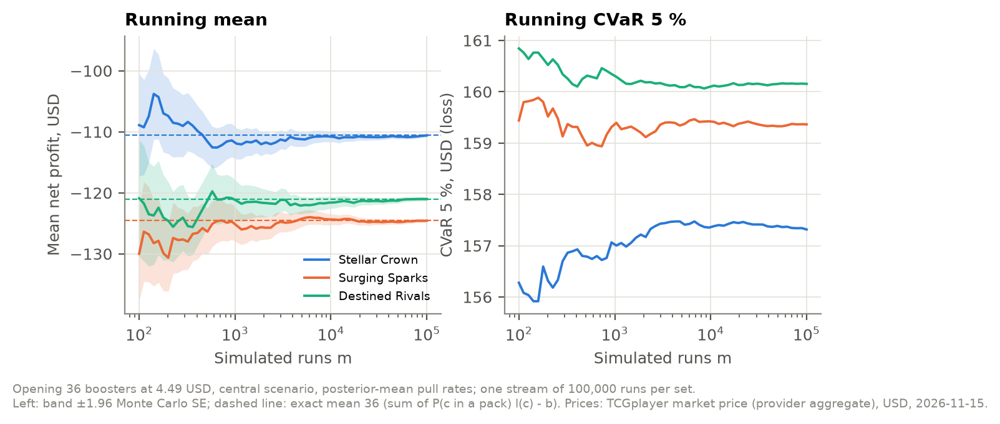
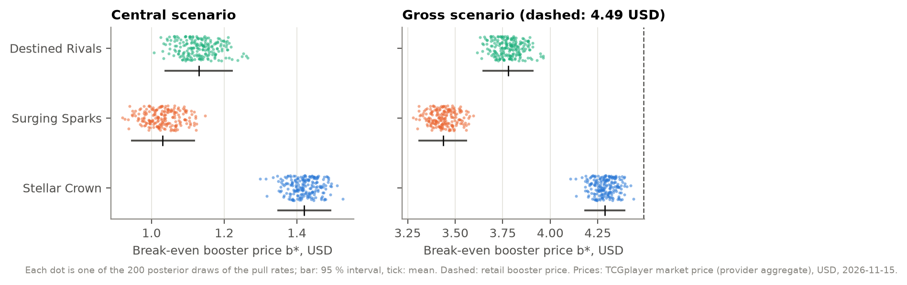
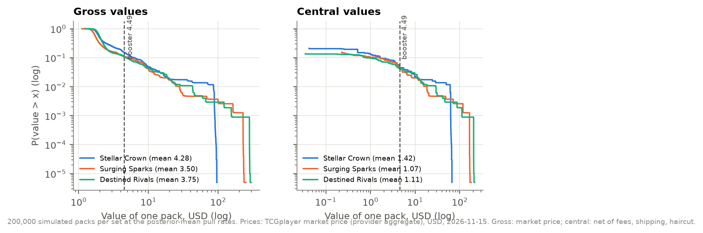
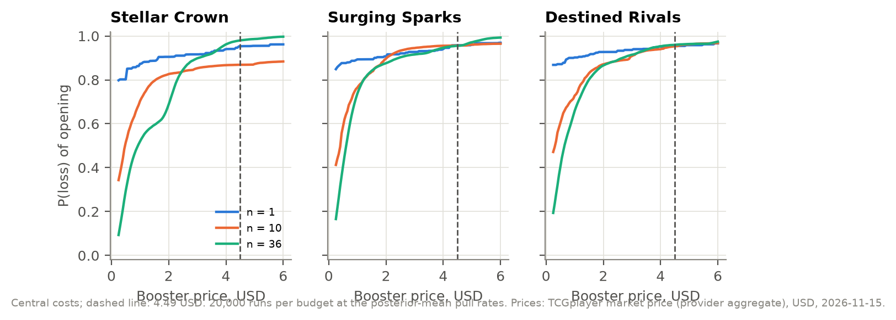

# Opening or Buying? A Probabilistic and Risk-Adjusted Comparison of Pokémon TCG Booster Acquisition and Secondary-Market Purchases

<p class="author">Anh-Vu TA</p>

<p class="meta">Working paper, version 2, November 2026<br>Code, data and configurations: <a href="https://github.com/Azekf11/PokeQuant">https://github.com/Azekf11/PokeQuant</a> · DOI <a href="https://doi.org/10.5281/zenodo.24251050">10.5281/zenodo.24251050</a></p>

# Abstract

Collectors of Pokémon trading cards can obtain a card by opening booster packs
or by buying it on the secondary market. I compare the two strategies for
three recent English sets with a slot-level model of the booster pack,
Bayesian posteriors on community-measured pull rates, and a nested Monte Carlo
simulation (200 posterior draws × 20,000 runs). Cards are valued at dated
TCGplayer market prices net of published fees, shipping and a liquidity
haircut. Hypotheses, metrics and decision rules were pre-registered. Under
central costs the break-even booster price is 1.03 to 1.42 USD, against a
retail price of 4.49 USD. Opening 36 boosters loses 111 to 125 USD on average,
and buying the same value directly is better on the mean, the median and the
5 % conditional value-at-risk in 35 of 36 comparisons. The average loss from
opening holds in sixteen robustness variants, on seven further sets and at
European sale prices, and buying stays decisively better for every budget of
ten boosters or more in all ten sets. Selling costs drive the result: for two
sets, a pack's gross market value exceeds its retail price. Pull-rate
uncertainty widens every interval but changes no main conclusion.

*Keywords:* collectibles, loot boxes, Monte Carlo simulation, Bayesian
uncertainty, expected shortfall, pre-registration.

*JEL codes:* C11, C15, D12, D81, Z11.

# 1. Introduction

A booster pack of the Pokémon Trading Card Game is a lottery over cards. An
English pack holds ten game cards. Most are worth less than the cost of
selling them, while a few rare printings trade for tens or hundreds of
dollars. A collector who wants those cards can open packs and sell what they
do not keep, or buy the cards directly. Online guides settle the choice with
an expected value, the sum over cards of price times pull rate, compared with
the price of a pack. That number leaves out four things. The value of a pack
is highly skewed, so its mean says little about a typical opening. Pull rates
for English sets are not published by the manufacturer and must be estimated
from community openings. A market price is not what a seller receives once
fees, shipping and the discount needed to sell are paid. And the relevant
alternative is to buy the same cards, which has costs too.

This paper asks to what extent opening boosters is an economically
competitive way to acquire cards, compared with buying them directly. I study
three recent English sets, Stellar Crown, Surging Sparks and Destined Rivals,
and two comparisons fixed before any price was analysed. In the first (E1),
a budget is spent on boosters and every card is sold, or the same budget buys
the most expensive single cards and they are sold back. In the second (E2),
packs are opened until a chosen card appears, or that card is bought.

The method has three parts. A booster is modelled slot by slot, with rarity
probabilities given Dirichlet posteriors estimated from community openings.
Cards are valued at a dated provider market price and converted into net
realisable values under three cost scenarios. A nested Monte Carlo simulation
then propagates both the uncertainty on the pull rates (200 posterior draws)
and the randomness of the packs (20,000 runs per draw). I report means,
medians, probabilities of loss and the 5 % conditional value-at-risk, each
with its Monte Carlo error and its interval over pull-rate uncertainty.
Hypotheses, metrics, decision rules and robustness tests were registered as
signed git tags before the results existed, and one command regenerates every
table and figure.

Three findings stand out. First, opening loses money on average. Under
central costs, the break-even booster price, below which opening has a
positive expected profit, is 1.03 to 1.42 USD against a retail price of 4.49
USD. Without any fee, shipping or haircut it is still 3.44 to 4.29 USD.
Second, buying is the better way to acquire cards. Opening 36 boosters
loses 111 to 125 USD on average; buying and reselling the same value loses
46 to 51 USD. Buying is decisively better on the mean, the median and the
CVaR in 35 of 36 budget comparisons. Third, chasing one valuable card by
opening rarely pays: opening until the set's most valuable card appears is
cheaper than buying it in only 4 % to 14 % of simulated runs. These results
survive sixteen pre-registered robustness variants and two pre-registered
extensions. On seven further sets, opening still loses on average and buying
still wins for every budget of ten boosters or more, although for two sets a
pack's gross market value exceeds its retail price. At European sale prices,
opening still loses on average under central costs.

**Related literature.** Studies of collectibles as assets measure long-run
returns and stress transaction costs (Burton and Jacobsen 1999; Dimson and Spaenjers 2011; Mei and Moses 2002; Renneboog and Spaenjers 2013), and recent work covers
LEGO sets, sealed trading-card products and video-game items
(Dobrynskaya and Kishilova 2022; Wang and Langelett 2023; Dobrynskaya and Strelnikov 2025). These
papers ask whether holding a collectible pays; I ask an earlier question,
what it costs to obtain one. Work on Pokémon cards concerns price
determinants, grading and market efficiency (Danz 2026; Baro 2026; Sharma 2026), and a field study of 300 cards listed
on eBay for a year found that 73 % sold and that posted prices acted as a
ceiling on realised prices (Heck et al. 2026); I use it to anchor one liquidity
scenario. Booster packs belong to the family of randomised products studied
as loot boxes, gacha and blind boxes (Chen et al. 2021; Gan 2021; Hu et al. 2024), with a public-health literature linking them to problem
gambling (Zendle and Cairns 2018; Zendle et al. 2021). The closest formal work,
Mota (2026), models a sealed Magic: The Gathering product slot
by slot and lists the frictions that separate its price from the expected
value of its contents, with a hypothetical numerical example. I share the
slot-level expected value and the sale threshold, but use measured pull rates
and dated prices, treat the rates as uncertain, report the full distribution
and its tail, and compare opening with buying. The risk measure is the
expected shortfall (Artzner et al. 1999; Acerbi and Tasche 2002), and the
separation of epistemic and aleatory uncertainty follows Der Kiureghian and
Ditlevsen (2009).

The paper proceeds as follows. Section 2 describes the data and how each
input was checked. Section 3 sets out the model and the simulation. Section 4
reports the results, Section 5 the robustness tests and extensions, and
Section 6 concludes. The appendix lists the source of every input, the
validation of the engine and the pre-registration record.

# 2. Data

Every input of the model has a dated source, listed in Appendix A. This
section describes the three kinds of data (pull rates, catalogue and prices),
the cost parameters, and the checks each input passed.

## 2.1 Pull rates

Per-pack rarity rates come from the Poké Life pull-rate evidence registry,
version 2026-11-13 (CC BY 4.0). It holds 234 rarity rows for 36 English sets,
compiled from 75 reviewed openings, of which 53 are flagged as qualifying.
Each row gives hits, packs, a rate and a 95 % interval for one hit rarity
(Double Rare and above, and ACE SPEC Rare). The rows of the selected sets pool
two openings: the TCGplayer Authentication Center (8,300 to 9,000 packs per
rarity row, reconstructed from its published margins) and one YouTube opening
series.

Two features of the registry matter for the model. First, its counts are
reconstructed: hits and packs were back-calculated from a published rate and
margin rather than tallied, for all 17 rows of the selected sets. If the
published margins were not binomial, posteriors built on these counts
overstate precision, so one robustness test halves their weight. Second, the
rarest outcomes rest on few hits: 64 to 86 Hyper Rares and 121 to 138 Special
Illustration Rares per set. This is why the uncertainty on the rates is
propagated rather than fixed at point estimates.

I checked the registry in three ways (Section 5.4 gives the details). Its
rates match the tables printed in the TCGplayer articles, read on 2026-11-15,
for all 33 single-source rows of the seven sets added in Section 5.2. Pooling
the two openings is not rejected by a χ² homogeneity test in any of the 16
testable rows (Holm–Bonferroni, 5 %). And in a held-out test, the TCGplayer
counts alone predict the second opening's hits inside the 95 % predictive
interval in 20 of 20 rows.

## 2.2 Sets and catalogue

The set selection rule (ADR 0005) was committed before any data were
analysed. A set is eligible if it is an English set of the Scarlet & Violet
series or later, with at least 5,000 packs measured, complete rarity rows, a
complete catalogue and at least 90 % price coverage of its Rare-and-above
cards. Of the 36 sets, 15 are eligible. They are ranked by data quality, and
the top three are Destined Rivals (sv10), Surging Sparks (sv08) and Stellar
Crown (sv07). The other twelve are used in Section 5.2.

The catalogue comes from TCGdex (MIT licence), fetched on 2026-11-15. For the
three sets, the number of cards in each hit rarity matches the registry
exactly, and the ingestion rejects any snapshot where the two sources
disagree. Table 1 summarises the selected sets.

**Table 1.** Selected sets.

| | Stellar Crown | Surging Sparks | Destined Rivals |
|---|---|---|---|
| TCGdex id, release | sv07, 2024-09-13 | sv08, 2024-11-08 | sv10, 2025-05-30 |
| Packs measured, maximum over rows | 10,800 | 11,254 | 12,446 |
| Rarity rows (high confidence) | 6 (6) | 6 (6) | 5 (5) |
| Catalogue size | 175 | 252 | 244 |

*Source:* Poké Life registry 2026-11-13; TCGdex 2026-11-15;
`research/reports/data_audit.md` and `valuation.md`. Of the 1,126 printings
a pack of the three sets can contain, 1,119 have a market price. The seven
others are in Stellar Crown; they take the median price of their pool
(central) or zero (adverse).

## 2.3 Prices

Cards are valued at the TCGplayer market price in USD, relayed by TCGdex on
2026-11-15, with every observation time-stamped by the provider (2026-11-14,
22:22 to 22:24 UTC). The market price is a provider aggregate of recent sales
and listings, not a single transaction, and card condition is not specified.
Listing prices are never used as transaction values. Prices are used with the
permission of TCGdex for this non-commercial project; only derived statistics
are published (ADR 0009). Section 5.3 replaces them with Cardmarket's 30-day
average sale prices as a check.

## 2.4 Costs

A seller receives the net liquidation value

ℓ(c) = max{0, p(c)(1 − h)(1 − f_m − f_p) − f_0 − s},  (1)

and a buyer pays the acquisition cost a(c) = p(c)(1 + f_b) + s_b, one card per
transaction, where p(c) is the market price of printing c. Table 2 gives the
three cost scenarios and the source of each value.

**Table 2.** Cost scenarios (USD) and sources.

| Parameter | Gross | Central | Adverse | Source |
|---|---|---|---|---|
| Booster price b | 4.49 | 4.49 | 5.49 | Assumption: US retail price at launch; b\* is reported so any b can be used |
| Marketplace fee f_m | 0 | 10.75 % | 10.75 % | TCGplayer seller fee page, read 2026-11-15 |
| Payment fee f_p, fixed fee f_0 | 0, 0 | 2.5 %, 0.30 | 2.5 %, 0.30 | TCGplayer seller fee page, read 2026-11-15 |
| Shipping per sale s, per purchase s_b | 0, 0 | 1.00, 1.00 | 4.50, 4.50 | Assumption: untracked (central) or tracked (adverse) letter |
| Liquidity haircut h | 0 | 0.15 | 0.30 | Assumption; anchored on Heck et al. (2026) in robustness test R10 |

The gross scenario is a reference without frictions, never the main result.
Under central costs a card is worth selling only if its price exceeds about
1.76 USD, since the fixed fee and shipping alone cost 1.30 USD.

# 3. Model and simulation

## 3.1 The booster pack

A pack is a sequence of slots s = 1, …, S. Slot s draws a rarity r with
probability π_s(r), then one printing uniformly from the pool P_s(r) of that
rarity. The probability that printing c appears in slot s is

q_s(c) = π_s(r(c)) / |P_s(r(c))|.  (2)

The modelled pack has ten slots: four Commons and three Uncommons, which are
fixed, and three random slots taken from the TCGplayer pull-rate articles.
The first reverse-holo slot can be replaced by an ACE SPEC Rare; the second
by an Illustration Rare, a Special Illustration Rare or a Hyper Rare; and the
rare slot holds a Rare, a Double Rare or an Ultra Rare. Figure 1 shows the
layout for Surging Sparks. The Basic Energy and the code card have no value.
Slots are independent, printings are equally likely within a pool, and the
Commons and Uncommons of one pack are distinct cards. Robustness tests move
the Hyper Rare to the rare slot (R12) and add a documented short print (R11).


## 3.2 Uncertainty on the pull rates

For a random slot whose k hit rarities were observed x_1, …, x_k times in n
packs, the posterior of the slot probabilities under a Jeffreys prior is

(π_s(r_1), …, π_s(r_k), π_s(rest)) ~ Dirichlet(x_1 + ½, …, x_k + ½, n − Σ x_i + ½).  (3)

When the rows of one slot rest on different numbers of packs, each rate is
converted to pseudo-counts on the smallest of them, which never overstates
the information. The registry's own intervals are Jeffreys intervals on its
counts, so the posterior reproduces them.

## 3.3 Strategies and profit

With liquidation values ℓ from (1), the profit of opening n packs at price b
is

Π_A = Σ_{i=1}^{10n} ℓ(C_i) − n b,  (4)

where C_i are the cards drawn. In E1, strategy B spends the same budget nb on
the most expensive printings of the set, in decreasing order of a(c), and
sells them back: Π_B = Σ_c [ℓ(c) − a(c)], a deterministic amount. The
budgets are 1, 10, 36 and 100 boosters (36 is one booster box).

In E2, strategy A opens packs until the target c\* appears, sells every other
card, and buys c\* if it has not appeared after n_max = ⌈3 / p_hit(c\*)⌉
packs, where p_hit(c\*) = 1 − ∏_s (1 − q_s(c\*)) is its per-pack probability.
Its profit is Π_A = a(c\*) − K_net, where K_net is the cost of the packs
opened net of the other cards sold. Strategy B buys the target, so Π_B = 0.
The targets are each set's most expensive printing and its most expensive
Special Illustration Rare.

Because (4) is linear, the expected profit of opening has a closed form. The
break-even booster price,

b\* = Σ_c P(c in a pack) ℓ(c) = Σ_c Σ_s q_s(c) ℓ(c),  (5)

is the price at which E[Π_A] = 0. It does not depend on b, so a reader can
compare it with any booster price.

## 3.4 Nested Monte Carlo

The other metrics have no closed form. Algorithm 1 estimates them with two
nested loops that keep the two sources of uncertainty apart: the outer loop
draws pull rates from (3) (epistemic uncertainty), and the inner loop draws
packs at fixed rates (aleatory uncertainty).

```text
Algorithm 1. Nested Monte Carlo (seed 20261115, K = 200, M = 20,000)

for k = 1..K:                                   # epistemic loop
    draw π^(k) from the Dirichlet posteriors (3), one per random slot
    compute q_s^(k)(c) by (2) and b*^(k) by (5)
    for m = 1..M:                               # aleatory loop
        E1: for each slot s, draw the counts of each printing in n packs
            from Multinomial(n, q_s^(k)); value them with l; Π_A by (4)
        E2: draw the number of packs K ~ Geometric(p_hit^(k)(c*)),
            capped at n_max; value the other cards; Π_A = a(c*) − K_net
    compute, over the M runs: mean, median, P(Π < 0), quantiles,
        VaR 5 %, CVaR 5 %, and their Monte Carlo standard errors
report, for each metric: its mean and 2.5–97.5 % quantiles over the K draws
compare A and B: "decisive" if one is better in ≥ 90 % of the K draws
```

The multinomial step draws all copies of a slot at once, so a run of n packs
costs the same as a run of one pack. It is exact for slots drawn with
replacement; the distinctness of Commons within a pack, which it ignores,
changes the standard deviation of the value of ten packs by about 1 %. The E2
step is exact under slot independence: the K − 1 packs before the hit are
drawn conditional on not containing c\*, and the hit pack with c\* in its
slot. CVaR 5 % is minus the mean of the ⌈0.05 M⌉ = 1,000 worst runs, a
consistent estimator of expected shortfall for discrete as well as
continuous outcomes (Acerbi and Tasche 2002). Monte Carlo standard errors use
20 batch means. All random streams derive from one seed through NumPy's
`SeedSequence` (PCG64), one stream per draw, so results do not depend on the
order of execution, and every run writes a manifest with a SHA-256 hash of
its results.

## 3.5 What the simulation shows

Figure 2 runs the inner loop of Algorithm 1 for 100,000 runs of 36 boosters
at the posterior-mean rates. The running mean converges to the closed-form
mean of (5): after 100,000 runs it lies 0.13 to 0.48 standard errors from it
in each set, while after 100 runs it can be more than 5 USD off. The CVaR
settles more slowly, because it rests on the worst 5 % of runs only: with
1,000 runs it is within 0.4 USD of its 100,000-run value, but its tail holds
just 50 runs. The main run uses M = 20,000 runs per draw so that every tail
estimate rests on at least 1,000 runs.



Figure 3 shows the outer loop: the 200 posterior draws of b\*. The spread
across draws is the epistemic uncertainty that a fixed-rate calculator
ignores. It is small relative to the gap with the booster price: for the
mean profit of 36 boosters, the standard deviation across draws (1.45 to
1.81 USD) is about five times the Monte Carlo error within a draw (0.31 to
0.34 USD), so the reported intervals are dominated by what is unknown about
the rates, not by simulation noise.



The engine was also checked against exact results before any price was used
(Appendix C): per-slot card frequencies pass χ² tests, the root-mean-square
error of the mean falls with a log-log slope of −0.52 against −0.5 in theory,
the multinomial and card-by-card samplers agree (Kolmogorov–Smirnov p = 0.91),
and the same seed reproduces the same output.

## 3.6 Pre-registered hypotheses and decision rule

Four hypotheses were registered before any price was analysed. H1: the mean,
the median and the CVaR can rank the strategies differently. H2: a verdict
that is decisive at the posterior-mean rates can become undetermined once
rate uncertainty is propagated. H3: fees and liquidity costs reduce the
advantage of opening. H4: the winner differs across sets or price dates. A
strategy is decisively better on a metric if it is better in at least 90 % of
the 200 posterior draws; otherwise the comparison is undetermined.

# 4. Results

All amounts are in USD, conditional on the TCGplayer market prices of
2026-11-15 and on the cost scenarios of Table 2. Brackets give 95 % intervals
over the 200 posterior draws of the pull rates.

## 4.1 The value of a pack

Without any fee, shipping or haircut, the break-even booster price b\* is
4.29 [4.18, 4.39] for Stellar Crown, 3.44 [3.31, 3.56] for Surging Sparks and
3.78 [3.65, 3.91] for Destined Rivals: all below the retail price of 4.49.
Under central costs it falls to 1.42, 1.03 and 1.13, and under adverse costs
to between 0.52 and 0.78. The fall comes from the fixed cost of a sale. In
79 % to 86 % of simulated packs no card is worth more than its selling cost,
so the net value of the pack is zero and the value of opening sits in a thin
tail of rare hits (Figure 4).



## 4.2 Spending a budget (E1)

Under central costs, opening loses money on average for every set and
budget, with every 95 % interval below zero. Table 3 reports the budget of 36
boosters. Opening loses 110.56 to 124.56 on average and more in the median
run, and it loses money in 95.5 % to 98 % of runs. Buying the most expensive
cards the budget allows and selling them back also loses money, through
round-trip fees and shipping, but 46 to 51: less than half as much.

**Table 3.** Budget of 36 boosters (161.64 USD), central scenario.

| | Stellar Crown | Surging Sparks | Destined Rivals |
|---|---|---|---|
| Break-even booster price b\* | 1.42 [1.35, 1.49] | 1.03 [0.95, 1.12] | 1.13 [1.04, 1.22] |
| A, open: mean Π | −110.56 [−113.33, −107.88] | −124.56 [−127.74, −121.32] | −120.97 [−124.35, −117.55] |
| A, open: median Π | −128.39 [−131.93, −124.88] | −139.55 [−140.94, −138.12] | −138.36 [−140.12, −136.25] |
| A, open: P(Π < 0) | 0.980 [0.975, 0.984] | 0.955 [0.946, 0.963] | 0.957 [0.949, 0.966] |
| A, open: CVaR 5 % (loss) | 157.33 [156.86, 157.78] | 159.39 [159.01, 159.71] | 160.15 [159.90, 160.45] |
| B, buy and resell: Π | −48.55 | −50.60 | −46.48 |
| Decisive winner (mean / median / CVaR) | B / B / B | B / B / B | B / B / B |

*Source:* `research/reports/results.md`, which gives every budget and
scenario.

Across all budgets and sets, buying is decisively better on the mean, the
median and the CVaR in 35 of the 36 central comparisons. The exception is the
mean for Stellar Crown at a one-booster budget, which is undetermined: there
the two strategies differ by less than 0.40. Figure 5 shows the whole
distribution for 36 boosters, and Figure 6 the probability of a loss as a
function of the booster price. Even at 2 USD a pack, opening 36 packs loses
money in most runs.




## 4.3 Chasing one card (E2)

The most valuable printings are rare: one pack in 168 [158, 179] for Stellar
Crown's top card, one in 904 [765, 1,072] for Surging Sparks' and one in
1,008 [875, 1,174] for Destined Rivals'. Under central costs, opening until
the target appears is cheaper than buying it in only 4 % to 14 % of runs, and
costs 468 to 3,145 more than buying on average. In the worst 5 % of runs it
costs 1,755 to 10,731 more (CVaR 5 %). Buying is decisively better on all
three metrics for every set and target, in all three cost scenarios, with
one exception: under gross prices, opening for Stellar Crown's top card is
cheaper in 52 % of runs and the median verdict is undetermined.

## 4.4 Hypotheses

H1 is supported, narrowly. Only under adverse costs at a one-booster budget,
for Stellar Crown and Surging Sparks, does the mean favour opening while the
median and the CVaR favour buying: a single direct purchase pays 4.50 of
shipping. Elsewhere the three metrics agree. H2 is supported once: for
Stellar Crown's top card under gross prices, the median favours opening at
the posterior-mean rates but becomes undetermined once rate uncertainty is
propagated. H3 is supported: for every set and every budget of ten boosters
or more, costs reduce the advantage of opening, and in E2 they lower the
probability that opening beats buying by 0.12 to 0.38. H4 is not supported
across the three sets, since buying wins in each.

# 5. Robustness and extensions

I check three conclusions, all under central costs. C1: the 95 % interval of
the mean profit of opening is below zero for every set and budget. C2: the
upper 95 % bound of b\* is below 4.49, both central and gross. C3: buying is
decisively better on the mean, the median and the CVaR for every budget of
ten boosters or more and every target.

## 5.1 Pre-registered robustness tests

Each of the sixteen variants changes one assumption and keeps the seed, the
draws and the runs. Variants that change only card values reuse the
simulated openings of the main run, so differences come from the assumption,
not from simulation noise; the baseline reproduces the main run exactly.
Table 4 reports the central b\* and the checks.

**Table 4.** Robustness variants: central break-even price b\* (posterior
mean) and conclusions C1–C3.

| Variant | b\* sv07 | b\* sv08 | b\* sv10 | C1 | C2 | C3 |
|---|---|---|---|---|---|---|
| Baseline | 1.42 | 1.03 | 1.13 | yes | yes | yes |
| R1 median of price statistics | 1.51 | 1.12 | 1.26 | yes | no | yes |
| R2 haircut 0.30 / 0.50 | 1.12 / 0.73 | 0.81 / 0.54 | 0.90 / 0.60 | yes | yes | yes |
| R3 selling costs × 0.5 / × 1.5 | 1.74 / 1.17 | 1.25 / 0.85 | 1.34 / 0.95 | yes | yes | yes |
| R4 rates at lower / upper bounds | 1.30 / 1.54 | 0.91 / 1.17 | 0.99 / 1.28 | yes | yes | yes |
| R5 top 1 % of printings excluded | 0.59 | 0.57 | 0.64 | yes | yes | yes |
| R7 1,000 / 10,000 / 100,000 runs | 1.42 | 1.03 | 1.13 | yes | yes | yes |
| R8 uniform prior | 1.42 | 1.03 | 1.13 | yes | yes | yes |
| R9b half effective sample size | 1.42 | 1.03 | 1.13 | yes | yes | yes |
| R10 haircut 0.27 (Heck et al.) | 1.18 | 0.86 | 0.95 | yes | yes | yes |
| R11 short-printed Double Rare | 1.42 | n/a | n/a | yes | yes | yes |
| R12 Hyper Rare in the rare slot | 1.42 | 1.03 | 1.13 | yes | yes | yes |

*Source:* `research/reports/robustness.md`, with intervals and the change in
the gap at 36 boosters. Paired variants (R2, R3, R4, R7) pass every check in
both settings.

C1 and C3 hold in every variant. C2 fails once: when cards are valued at the
median of TCGplayer's listing and market statistics (R1), the gross b\* of
Stellar Crown has a posterior mean of 4.42 but an upper bound of 4.53. Across
all variants the central b\* stays between 0.54 and 1.74, at most 39 % of the
retail price.

Figure 7 shows what moves the results. Liquidation assumptions set the size
of the gap: a haircut of 0.50 roughly halves b\*, and excluding the 1 % most
valuable printings lowers it by 0.46 to 0.83. Pull-rate assumptions barely
matter: the prior, the effective sample size and the slot of the Hyper Rare
leave b\* unchanged at two decimals, and even setting every rate at a bound
of its interval at once moves it by at most 0.15. With fewer runs per draw,
only comparisons at a one-booster budget change verdict, where the
strategies differ by less than 0.40. H2 depends on such a comparison, so I
report it as supported but fragile.


## 5.2 Ten sets

ADR 0015 (tag `prereg-v4`) extends the main experiment to every eligible set
that fits the main pack layout. Seven of the twelve other eligible sets do:
Scarlet & Violet, Paldea Evolved, Obsidian Flames, Paradox Rift, Temporal
Forces, Twilight Masquerade and Journey Together. The four Mega Evolution sets
have a "Mega Hyper Rare" with no slot in the layout, and 30th Celebration has
rarities absent from the catalogue; no layout was invented for them. The run
uses the configuration, seed and price snapshot of the main run. Random
streams are keyed by a set's position in the configuration, so the three main
sets are re-simulated with new streams; their central and gross b\* are
identical to two decimals.


C1 and C3 hold in all ten sets. Opening loses on average for every budget,
and buying is decisively better on the mean, the median and the CVaR for
every budget of ten boosters or more and every target. The central b\* ranges
from 0.60 (Journey Together) to 2.38 (Paldea Evolved) (Figure 8). C2 fails for
two sets, whose gross b\* exceeds the retail price: 5.29 [5.12, 5.48] for
Paldea Evolved and 5.00 [4.87, 5.18] for Temporal Forces. For these sets a
pack's expected market value is above its price, and the loss from opening
comes entirely from selling costs. Without frictions, opening one or ten of
their boosters has a positive mean but loses money in more than half of the
runs, a clear case of H1.

H4 across sets is now supported, but only at a one-booster budget. There,
opening has the higher mean for Paldea Evolved, Temporal Forces and Stellar
Crown, by 0.08 to 1.07 USD, and buying for five other sets. For every budget
of ten boosters or more and every target, buying wins in all ten sets. Stellar
Crown's one-booster verdict, undetermined in the main run (opening better in
89.5 % of draws), becomes decisive here (92 %) with different random streams:
it is the near tie noted in Section 5.1. Every hypothesis keeps its status
when the two flagged sets are removed. Full results are in
`research/reports/extension_sets.md`.

## 5.3 Sale prices

The TCGplayer market price is a provider aggregate, not an observed sale. As a
check, I revalued every card at Cardmarket's 30-day average sale price
(`avg30`), which the venue's API documentation defines as the average sale
price over the last 30 days, relayed by TCGdex for 2026-11-15 and converted
at the European Central Bank reference rate of 1.1052 USD per EUR
(2026-11-13). The exact b\* of (5) was recomputed in each posterior draw.
This extension was pre-registered before the values were analysed (ADR 0014,
tag `prereg-v3`).

**Table 5.** Break-even booster price b\* valued at Cardmarket sale prices,
2026-11-15 (USD).

| | Stellar Crown | Surging Sparks | Destined Rivals |
|---|---|---|---|
| Central, TCGplayer market price | 1.42 [1.35, 1.49] | 1.03 [0.95, 1.12] | 1.13 [1.04, 1.22] |
| Central, Cardmarket 30-day sales | 1.16 [1.10, 1.21] | 2.42 [2.32, 2.53] | 1.71 [1.55, 1.86] |
| Gross, Cardmarket 30-day sales | 2.89 [2.80, 2.98] | 4.75 [4.61, 4.91] | 3.46 [3.25, 3.68] |

*Source:* `research/reports/sales_benchmark.md`. Hit-printing coverage 100 %.

C1 holds in every set: under central costs, opening still loses on average
at sale prices. C2 fails for Surging Sparks, whose gross b\* of 4.75 exceeds
4.49; without any friction, its pack would be worth more than its price at
European sale prices. Over hit printings, the median ratio of the Cardmarket
sale average to the TCGplayer market price is 0.94 [0.87, 1.03] for Stellar
Crown and 1.22 [1.14, 1.31] and 1.23 [1.16, 1.33] for the two other sets
(bootstrap intervals, 49 to 87 printings). The haircut assumed in the central
scenario is therefore not visible in this comparison, although it mixes two
markets and two price types. A weekly panel of the same statistics until
2027-01-10 will test the date half of H4.

## 5.4 Pull-rate checks

Three checks were pre-registered for the pull rates (ADR 0015, tag
`prereg-v4`). First, the registry was compared with its primary source: for
the seven added sets, all 33 single-source rows equal the rate printed in the
TCGplayer article to two decimals. Second, a duplicate check found that the
Paradox Rift and Paldea Evolved articles print the same Ultra Rare
(6.64 % ± 0.53 %) and Illustration Rare (7.70 % ± 0.56 %) rates. Two
independent samples rarely agree this closely on two rarities, so both sets
are flagged; Section 5.2 shows that removing them changes no conclusion. Third,
in a held-out test, a Jeffreys posterior on the TCGplayer counts alone
predicts the hits of the second opening in its own packs. In all 20 pooled
rows the observed hits fall inside the 95 % beta-binomial predictive
interval, and the smallest two-sided p-value is 0.161, so no row is rejected
after Holm correction. Pooling the two openings, as the main analysis does,
is consistent with the data.

# 6. Conclusion

For ten recent English Pokémon sets valued at dated market prices, under explicit
costs and propagated pull-rate uncertainty, opening boosters is not a
competitive way to acquire cards. In the three main sets, a pack's expected net resale value is
about a quarter to a third of its retail price, and buying the same cards directly
loses less than half as much for the same budget. Buying is decisively better
on the mean, the median and the tail. Chasing one valuable card by opening is
rarely cheaper than buying it.

Two mechanisms drive the result. The fixed cost of selling one card exceeds
the value of most cards in a pack, so the value of opening rests on a few rare
hits. And for most sets, even without any friction, the expected market value
of a pack is below its retail price; for the two sets where it is above
(Paldea Evolved and Temporal Forces), selling costs alone turn the gain into
a loss. The uncertainty on
the pull rates, which a fixed-rate calculator ignores, is real but small
compared with this gap: it widens every interval and changes no main
conclusion.

The results have limits. Prices come from one provider on one date, and
card condition is not specified; European sale prices give the same main
conclusion, but a weekly panel is still being collected. The liquidity
haircut and shipping costs are assumptions, and each card is sold alone,
whereas bundled sales would lower shipping per card for both strategies. The
pull rates come from community openings compiled by a third party, with
reconstructed counts; a bias common to all openings, such as selective
reporting, would not be detected. Slots are assumed independent and printings
equally likely within a rarity. Finally, the model prices neither the
entertainment of opening nor the cards a collector keeps. At the central
estimate, that experience costs 3.07 to 3.46 USD per pack.

The framework is general. It needs per-rarity pull rates with sample sizes, a
documented slot layout, a typed price snapshot and explicit costs, and one
configuration file reruns it on a new set, date or cost assumption.

# References

Acerbi, Carlo and Tasche, Dirk (2002). On the coherence of expected shortfall. *Journal of Banking & Finance, 26(7), 1487–1503*. <https://doi.org/10.1016/S0378-4266(02)00283-2>

Artzner, Philippe, Delbaen, Freddy, Eber, Jean-Marc and Heath, David (1999). Coherent Measures of Risk. *Mathematical Finance, 9(3), 203–228*. <https://doi.org/10.1111/1467-9965.00068>

Baro, Philipp (2026). A Hedonic Pricing Model for Graded Pokémon Trading Cards. *SSRN working paper*. <https://doi.org/10.2139/ssrn.6677998>

Burton, Benjamin J. and Jacobsen, Joyce P. (1999). Measuring Returns on Investments in Collectibles. *Journal of Economic Perspectives, 13(4), 193–212*. <https://doi.org/10.1257/jep.13.4.193>

Chen, Ningyuan, Elmachtoub, Adam N., Hamilton, Michael L. and Lei, Xiao (2021). Loot Box Pricing and Design. *Management Science, 67(8), 4809–4825*. <https://doi.org/10.1287/mnsc.2020.3748>

Danz, Thomas (2026). Gotta Catch 'Em All: How Scarcity, Sentiment, and Secondary Markets Influence Pokémon TCG Financial Dynamics. *Senior thesis, Princeton University, Department of Economics*. <https://theses-dissertations.princeton.edu/handle/88435/dsp01c247dw57w>

Der Kiureghian, Armen and Ditlevsen, Ove (2009). Aleatory or epistemic? Does it matter?. *Structural Safety, 31(2), 105–112*. <https://doi.org/10.1016/j.strusafe.2008.06.020>

Dimson, Elroy and Spaenjers, Christophe (2011). Ex post: The investment performance of collectible stamps. *Journal of Financial Economics, 100(2), 443–458*. <https://doi.org/10.1016/j.jfineco.2010.12.005>

Dobrynskaya, Victoria and Kishilova, Julia (2022). LEGO: The toy of smart investors. *Research in International Business and Finance, 59, 101539*. <https://doi.org/10.1016/j.ribaf.2021.101539>

Dobrynskaya, Victoria and Strelnikov, Vladimir (2025). Videogame Attributes as Alternative Investments. *The Quarterly Journal of Finance, 15(4)*. <https://doi.org/10.1142/S201013922640001X>

Gan, Tan (2021). Gacha Game: When Prospect Theory Meets Optimal Pricing. *SSRN working paper; arXiv:2208.03602*. <https://doi.org/10.2139/ssrn.3790798>

Heck, Johannes, Schormann, Sarah, Krichevsky, Benjamin, Groh, Adrian, Pape, Thorben, Schröder, Sebastian, Glahn, Alexander, Schumacher, Carsten and Schulze Westhoff, Martin (2026). Sales characteristics of Pokémon trading cards: A prospective one-year field study. *PLOS ONE, 21(3), e0334289*. <https://doi.org/10.1371/journal.pone.0334289>

Hu, Ming, Qin, Taojie and Sekar, Shreyas (2024). Pricing and Rarity Design of Blind Boxes with Random Items. *SSRN working paper*. <https://doi.org/10.2139/ssrn.4929281>

Mei, Jianping and Moses, Michael (2002). Art as an Investment and the Underperformance of Masterpieces. *American Economic Review, 92(5), 1656–1668*. <https://doi.org/10.1257/000282802762024719>

Mota, Arthur (2026). A Valuation Framework for Sealed Products in Collectible Card Markets: Expected Value, No-Arbitrage Pricing, and the Sealed-Opened Spread. *SSRN working paper*. <https://doi.org/10.2139/ssrn.6429278>

Renneboog, Luc and Spaenjers, Christophe (2013). Buying Beauty: On Prices and Returns in the Art Market. *Management Science, 59(1), 36–53*. <https://doi.org/10.1287/mnsc.1120.1580>

Sharma, Aman (2026). Grading Premiums and Price Volatility in the Pokémon Card Secondary Market: A 2020-2022 Boom-Bust Case Study. *SSRN working paper*. <https://doi.org/10.2139/ssrn.7515678>

Wang, Zhiguang and Langelett, George (2023). Sealed Collectible Card Game Product as Standalone Investment and Portfolio Diversifier. *Global Journal of Accounting and Finance, 7(1)*. <https://doi.org/10.47177/wwns9y63>

Zendle, David and Cairns, Paul (2018). Video game loot boxes are linked to problem gambling: Results of a large-scale survey. *PLOS ONE, 13(11), e0206767*. <https://doi.org/10.1371/journal.pone.0206767>

Zendle, David, Walasek, Lukasz, Cairns, Paul, Meyer, Rachel and Drummond, Aaron (2021). Links between problem gambling and spending on booster packs in collectible card games: A conceptual replication of research on loot boxes. *PLOS ONE, 16(4), e0247855*. <https://doi.org/10.1371/journal.pone.0247855>

# Appendix

## A. Sources of every input

**Table A1.** Inputs, sources and status in the replication package.

| Input | Value(s) used | Source and date | Licence or permission | In the package |
|---|---|---|---|---|
| Pull rates | Hits, packs, rates of every hit rarity | Poké Life pull-rate evidence registry, version 2026-11-13 | CC BY 4.0 | Yes, with SHA-256 checksums |
| Primary pull-rate tables | Printed rates and margins, ten sets | TCGplayer pull-rate articles, read 2026-11-15 | Facts cited with URLs | `research/reports/*tcgplayer_published_rates.csv` |
| Slot layout | Positions of hit rarities | TCGplayer pull-rate articles; model specification | Facts cited | Described |
| Catalogue | Cards, numbers, rarities, variants | TCGdex API, 2026-11-15 | MIT | Re-fetched by script |
| Prices (main) | TCGplayer market price, USD | TCGdex relay, provider time 2026-11-14 22:22–22:24 UTC | Permission for this non-commercial project (ADR 0009) | No; derived statistics and checksums only |
| Prices (check) | Cardmarket 30-day average sale price, EUR | TCGdex relay, 2026-11-15; definition from the Cardmarket API 2.0 documentation | Same as above | No; derived statistics only |
| Exchange rate | 1.1052 USD per EUR | ECB, series EXR.D.USD.EUR.SP00.A, 2026-11-13 | Public statistics | Cached request URL |
| Seller fees | 10.75 %, 2.5 % + 0.30 USD | TCGplayer seller fee page, read 2026-11-15 | Facts cited | `research/experiments/main.yaml` |
| Booster price | 4.49 USD (5.49 adverse) | Assumption: US retail price at launch; no official price list | n/a | Configuration |
| Shipping, haircut | 1.00 / 4.50 USD; 0.15 / 0.30 | Assumptions; R10 anchors the haircut on Heck et al. (2026) | n/a | Configuration |

Every price observation carries its date, currency, condition (unspecified)
and type (provider market aggregate or venue sale average). No listing price
is used as a transaction value, and missing prices are never set to zero
except in the adverse scenario, where this is stated.

## B. Definitions

| Metric | Definition |
|---|---|
| Mean, median | E[Π], q₀.₅(Π) |
| P(loss) | P(Π < 0) |
| VaR 5 % | −q₀.₀₅(Π), a positive loss |
| CVaR 5 % | −E[Π \| Π ≤ q₀.₀₅(Π)]; estimator: minus the mean of the ⌈0.05 M⌉ smallest of M runs |
| Break-even price b\* | Equation (5); E[Π_A] = n(b\* − b) in E1 |
| P(K < a(c\*)) | Share of runs in which opening until the target was cheaper than buying it |
| Interval | 2.5 % and 97.5 % quantiles over the 200 posterior draws |
| Monte Carlo error | Batch-means standard error (20 batches) within a draw, median over draws |
| Decisive | One strategy better in at least 90 % of the posterior draws |

## C. Validation of the engine

`scripts/validate_engine.py` checks the engine against exact results with
synthetic card values, before any price was used:

1. A one-slot toy case gives a simulated mean 1.76 standard errors from the
   exact value with N = 10⁶.
2. Simulated card frequencies in the three random slots of Surging Sparks
   pass a χ² test (p = 0.15, 0.64 and 0.54).
3. Hit counts of a Special Illustration Rare over 100 packs match the
   binomial distribution in mean, variance and P(at least one).
4. The root-mean-square error of the mean falls with a log-log slope of
   −0.52 (theory −0.5) from N = 10³ to 10⁶.
5. The multinomial and card-by-card samplers agree (Kolmogorov–Smirnov
   p = 0.91).
6. The capped number of packs to a target matches its closed form.
7. The same seed, data and model give identical output.

The full report is `research/reports/validation.md`. The exact b\* of
equation (5) also matches the break-even price computed by the engine within
a relative tolerance of 10⁻⁶ in the test suite (synthetic data).

## D. Simulation parameters

**Table A2.** Parameters of the main run.

| Parameter | Value |
|---|---|
| Sets | Stellar Crown (sv07), Surging Sparks (sv08), Destined Rivals (sv10) |
| Product | One English booster; 10 modelled slots (layout `tcgplayer`) |
| Prior | Jeffreys (a₀ = ½), weight 1 on every registry row |
| Epistemic draws K | 200 |
| Aleatory runs M | 20,000 per draw (1,000 runs in the 5 % tail) |
| Seed | 20261115 (NumPy PCG64 via SeedSequence) |
| E1 budgets | 1, 10, 36, 100 boosters |
| E2 targets | Most expensive printing; most expensive Special Illustration Rare; cap ⌈3 / p_hit⌉ |
| Decision threshold | 0.90 of posterior draws |
| Price date | 2026-11-15 |

## E. Pre-registration record

| Tag | Content | Fixed before |
|---|---|---|
| `prereg-v1` | Question, hypotheses H1–H4, metrics, decision rules | Any data analysis |
| `prereg-v2` | Booster model, sets, budgets, baskets, cost scenarios, robustness list | Any price value |
| `analysis-v1` | Frozen main run and robustness variants (Sections 4, 5.1) | Writing |
| `prereg-v3` | Sale-price benchmark and weekly panel (Section 5.3; ADR 0014) | Any Cardmarket value of the three sets |
| `prereg-v4` | Ten-set extension and pull-rate checks (Sections 5.2, 5.4; ADR 0015) | Any price or result of the added sets |

Deviations from `prereg-v1`, each recorded in an ADR: the test excluding
reconstructed counts is replaced by R9b, since every row of the selected sets
is reconstructed; valuation uses TCGplayer prices only, Cardmarket being an
exploratory check; and the booster price is a scenario, not an observation.
For `prereg-v4`, the duplicate rule was written after the Paradox Rift and
Paldea Evolved duplicate had been noticed (ADR 0015).

## F. Additional figures


## G. Reproduction

```bash
uv sync
make check        # lint, types and tests
make reproduce    # data, validation, main run, robustness, reports and figures
```

`make reproduce` needs the TCGdex responses in the local cache, fetched by
`pokequant ingest` on first use, and takes about three hours on eight cores.
The extensions run with `scripts/sales_benchmark.py`,
`scripts/pull_rate_checks.py` and `pokequant run
research/experiments/extension_sets.yaml`. Each run writes a manifest with
the configuration hash, seed, data snapshot identifiers and the SHA-256 of its
results.
