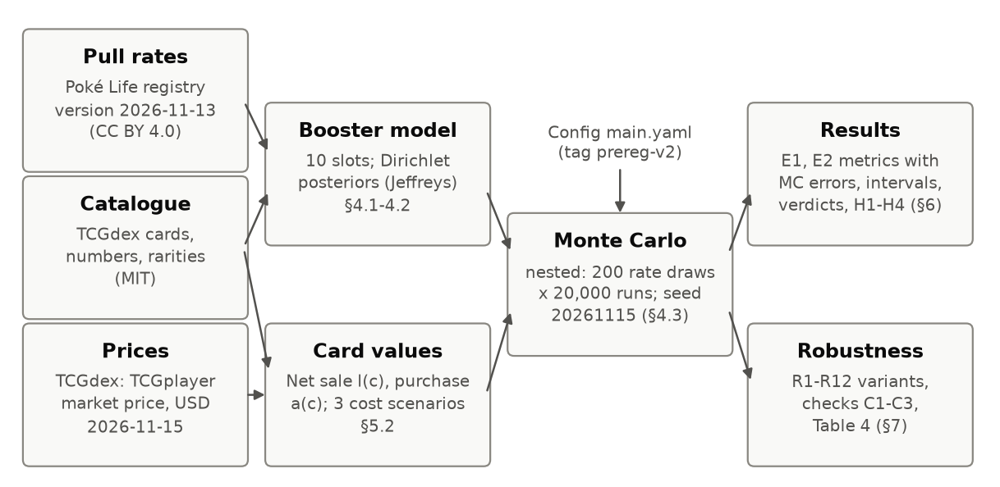
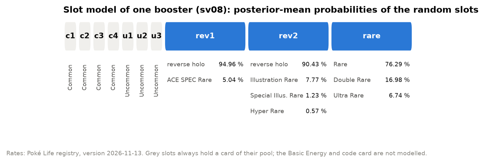
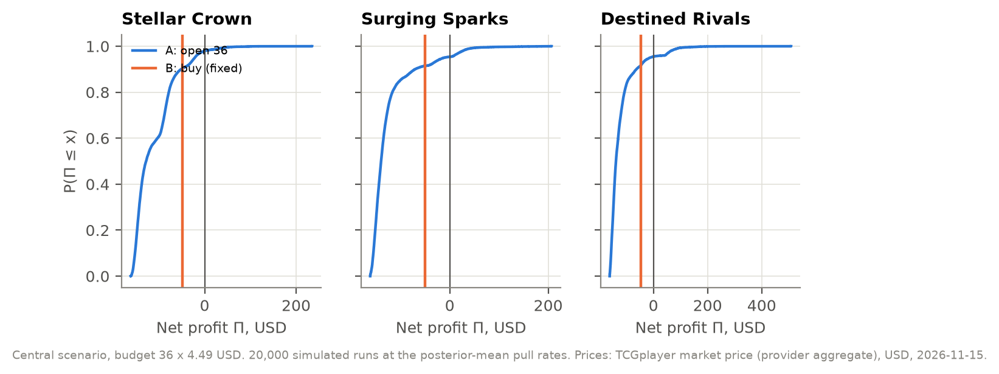
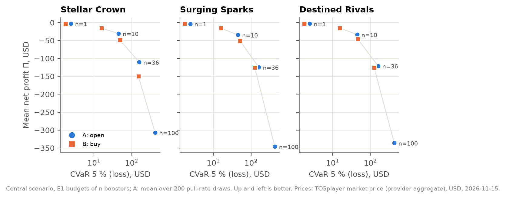
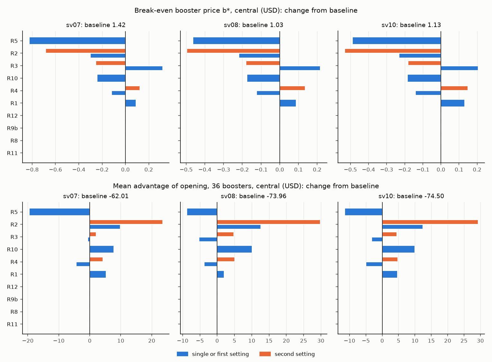
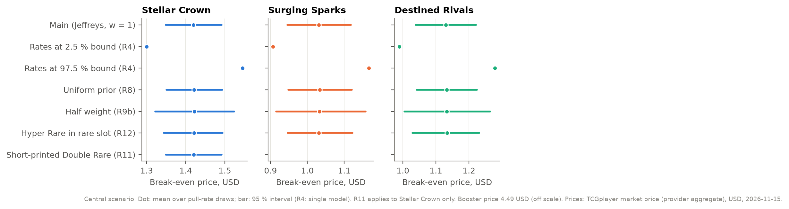

# Opening or Buying? A Probabilistic and Risk-Adjusted Comparison of Pokémon TCG Booster Acquisition and Secondary-Market Purchases

**Anh-Vu TA** · Working paper, November 2026 · Code, data and configurations: <https://github.com/Azekf11/PokeQuant>, DOI [10.5281/zenodo.24251050](https://doi.org/10.5281/zenodo.24251050)

# Abstract

Is opening Pokémon Trading Card Game booster packs a competitive way to
acquire cards, compared with buying them directly on the secondary market?
We model three recent English sets (Stellar Crown, Surging Sparks and
Destined Rivals) slot by slot. Rarity rates come from community openings,
with Dirichlet posteriors, and a nested Monte Carlo propagates their
uncertainty (200 posterior draws × 20,000 runs). Cards are valued at
TCGplayer market prices in USD on 2026-11-15, converted into net realisable
values under three cost scenarios. Hypotheses, metrics, decision rules and
robustness tests were pre-registered before any result existed.

Under the central scenario, opening loses money on average for every set and
budget. The break-even booster price is 1.03 to 1.42 USD against a retail
price of 4.49 USD, and 3.44 to 4.29 USD without any fee, shipping or
haircut. Opening 36 boosters loses 111 to 125 USD on average. Buying cards
directly also loses money through round-trip costs, but less than half as
much, and it is decisively better on the mean, the median and the 5 %
conditional value-at-risk in 35 of 36 budget comparisons. Opening until a
set's most valuable card appears is cheaper than buying it in only 4 % to
14 % of simulated runs. Opening's average loss and the advantage of buying
hold in all sixteen pre-registered robustness variants. Liquidation
assumptions change the size of the gap; pull-rate assumptions barely do. Code, configurations, the pull-rate
snapshot and all derived results are public, and one command regenerates
every table and figure.

*Keywords:* trading card games, loot boxes, Monte Carlo simulation, Bayesian
uncertainty, conditional value-at-risk, pre-registration, reproducibility.

# 1. Introduction

A Pokémon Trading Card Game booster pack is a lottery over cards. Each
English pack holds ten game cards, plus a Basic Energy and a code card. Most
cards are worth less than the cost of selling them, and a small number of rare
printings trade for tens or hundreds of dollars. A collector
who wants those cards has two routes:

- open packs and sell what they do not keep;
- buy the cards directly on the secondary market.

Online guides and calculators answer this question with an expected value: the
sum over cards of price × pull rate, compared with the price of a pack. That
number hides four things:

1. **The distribution.** The value of a pack is very skewed: its mean says
   little about what a typical opening returns.
2. **The odds.** For English sets, the pull rates are not published. They are
   estimated from community openings, with sampling error.
3. **The costs.** A listed or aggregated market price is not what a seller
   receives. Fees, shipping and the discount needed to sell all intervene, and
   a fixed cost per sale wipes out the value of cheap cards.
4. **The alternative.** The relevant comparison is not opening against
   nothing, but opening against buying the same value directly. Buying has
   costs too.

This paper asks, for three recent English sets: to what extent is opening
boosters an economically competitive way to acquire cards, compared with
buying them directly, once pull-rate uncertainty, value dispersion, fees and
liquidity are taken into account? We answer with two estimands, fixed before
any price was analysed:

- **E1, budget liquidation.** Spend a budget on boosters and sell every card,
  or buy the most expensive single cards the budget allows and sell them back.
- **E2, target acquisition.** Open boosters until a chosen card appears, or
  buy that card.

**Method.** We model a booster slot by slot. Rarity rates follow Dirichlet
posteriors estimated from community openings, and we propagate their
uncertainty through a nested Monte Carlo: 200 posterior draws of the rates,
each with 20,000 simulated runs. Cards are valued at a dated provider market
price, converted into net realisable values under three pre-registered cost
scenarios. We report means together with medians, probabilities of loss and
the 5 % conditional value-at-risk, each with its Monte Carlo error and its
interval over pull-rate uncertainty. Hypotheses, metrics, decision rules,
scenarios and robustness tests were registered in two stages, as signed git
tags, before the results existed. Every table and figure is regenerated by
one command.

**Results.** Under the central scenario, opening loses money on average for
every set and budget:

- The break-even booster price, below which opening would have a positive
  expected profit, is 1.03 to 1.42 USD against a retail price of 4.49 USD.
- Without any fee, shipping or haircut, it is still 3.44 to 4.29 USD.
- Opening 36 boosters loses 111 to 125 USD on average.
- Buying cards directly also loses, through its round-trip costs, but less
  than half as much. It is decisively better on the mean, the median and the
  CVaR in 35 of 36 comparisons.
- To obtain a set's most valuable card, opening until it appears is cheaper
  than buying it in only 4 % to 14 % of simulated runs.

**Robustness.** These conclusions survive sixteen pre-registered variants
(§7): other price statistics, haircuts up to 0.50, halved or increased
selling costs, pull rates at the bounds of their intervals, another prior,
the exclusion of the 1 % most valuable cards, and up to 100,000 runs per
draw. Opening loses on average and buying is decisively better in every
variant. The break-even booster price stays between 0.54 and 1.74 USD. The
gross break-even price stays below the retail price in every variant but
one, where its upper bound exceeds it.

**Contribution.** The contribution is not a new expected-value calculator. It
is a reproducible and pre-registered framework that combines four elements:

1. a slot-level booster model;
2. Bayesian uncertainty on community pull rates;
3. typed prices converted into net values;
4. tail-risk measures in a comparison with direct purchase.

The code, configurations, pull-rate snapshot and every derived result are
public. Raw prices are not redistributed, but the scripts that fetch them and
the checksums of the snapshot are.

The paper is organised as follows. Section 2 reviews related work. Section 3
describes the data. Section 4 sets out the model and the simulation engine,
and Section 5 the pre-registered design. Section 6 reports the results and
Section 7 their robustness. Section 8 discusses limits and implications, and
Section 9 concludes.

# 2. Related literature

The paper draws on five strands of work. For most of them we cite only what
the published abstract states. The `note` field of each bibliography entry
records what was read.

## 2.1 Collectibles as assets

The returns on collectibles are well studied, and the strand stresses
transaction costs:

- Burton and Jacobsen (1999) survey how such returns are
  measured.
- Dimson and Spaenjers (2011) report the long-run performance of
  stamps.
- Mei and Moses (2002) and Renneboog and Spaenjers
  (2013) study art.

Closer to our object, recent work covers sealed products:

- Dobrynskaya and Kishilova (2022) study LEGO sets as an
  investment.
- Wang and Langelett (2023) study sealed trading-card products as
  investments and portfolio diversifiers.
- Mota (2026) builds an index of sealed Magic: The Gathering booster
  boxes.
- Dobrynskaya and Strelnikov (2025) study video-game
  items, some of which are obtained from randomised loot boxes.

These studies ask whether holding a collectible pays. We ask a narrower,
earlier question: what does it cost to *obtain* cards by opening packs
rather than buying them?

## 2.2 Pokémon cards and their markets

**Price determinants.** Academic work on Pokémon cards concerns price
determinants, grading and market efficiency:

- Danz (2026) relates prices to scarcity and sentiment in a large
  panel of sets and tests weak-form efficiency. Access to this thesis is
  restricted; we know its abstract only.
- Baro (2026) estimates a hedonic model of graded card prices.
  This paper is linked to a commercial product.
- Sharma (2026) measures grading premiums over the 2020–2022
  boom and bust.

The hedonic approach goes back to Rosen (1974). Its use for
cards includes Mullin and Dunn (2002), who use baseball cards.
For a game that sells randomised packs, the most relevant hedonic result is
Hughes (2022): in Magic: The Gathering, a card's rarity
designation, which is set through pack odds, carries a price premium of its
own.

**Liquidity.** A field study bears directly on our liquidity assumptions.
Heck et al. (2026) listed 300 Pokémon cards on eBay for one year:

- 73 % of the cards sold;
- holo cards sold faster than others;
- posted prices acted as a ceiling on realised prices.

We use these figures to anchor one robustness scenario (R10). They come from
a different sample and platform, and we label them as transferred evidence.

## 2.3 Booster packs, loot boxes and odds disclosure

Booster packs belong to the family of randomised products. Several papers
model the design and pricing of such products:

- Chen et al. (2021) on loot boxes;
- Gan (2021) on gacha games;
- Hu, Qin and Sekar (2024) on blind boxes.

A public-health literature links spending on loot boxes and on physical
booster packs to problem gambling
(Zendle and Cairns 2018; Zendle et al. 2021; Xiao et al. 2025). Odds-disclosure
rules are not always followed: Xiao et al. (2023) report poor
compliance with the UK industry's self-regulation on loot-box probability
disclosure. For the English sets we study, the official product description
gives only the number of cards per pack. We therefore estimate pull rates
from community openings and treat them as uncertain (§3, §4).

## 2.4 Practitioner tools

Online guides and calculators already compute the expected value of a pack
from a price snapshot and published odds. Some also simulate the distribution
of a pack's value with fixed odds (S1 review,
`research/protocol/literature_review.md`). A pack-level Monte Carlo is
therefore not a contribution in itself. Neither is the observation that the
mean of a skewed value distribution exceeds its median.

The closest formal treatment is Mota (2026). According to its
abstract, it compares the price of a sealed Magic: The Gathering product with
the expected value of its contents if opened and sold. It defines a
"sealed-opened spread" with a no-arbitrage condition under perfect-market
assumptions. It discusses transaction costs, variance and liquidity, with a
generic numerical example. We could not obtain its full text. What follows
from its abstract alone is limited:

- it concerns another game;
- it is set under perfect-market assumptions;
- it does not mention a comparison with buying single cards, uncertainty on
  the odds, or tail risk.

## 2.5 Risk measures and nested simulation

**Risk measures.** We report the 5 % conditional value-at-risk (CVaR, or
expected shortfall), a coherent risk measure (Artzner et al. 1999).
Rockafellar and Uryasev (2000, 2002) study
its optimisation and its extension to general loss distributions.

Our simulated profits are discrete, with masses at a few values. For example,
a one-pack budget often yields the same loss in many runs. Acerbi and Tasche
(2002) show that a suitably defined expected shortfall is
coherent for any distribution with a finite mean loss, discrete or not (their
Prop. 3.1). They also show that minus the average of the ⌊nα⌋ worst simulated
outcomes converges to it (Prop. 4.1). With α = 5 % and 20,000 runs, this is
our estimator: 1,000 tail samples.

**Pull-rate uncertainty.** We separate the uncertainty on the pull rates
(epistemic) from the randomness of the packs (aleatory)
(Der Kiureghian and Ditlevsen 2009). Rates follow Beta and Dirichlet posteriors under
a Jeffreys prior (Jeffreys 1946). Jeffreys intervals perform well
for binomial proportions (Brown et al. 2001).

**Nested simulation.** Gordy and Juneja (2010) study a nested
simulation that estimates a risk measure of a conditional expectation. They
show that, as the budget grows, the inner sample size should grow only as its
cube root, and the number of outer scenarios as its two-thirds power.

Our design answers a different question. We do not estimate a risk measure of
the conditional mean. Every metric is computed *within* one draw of the rates,
on 20,000 simulated runs, and the draws only give its posterior interval.
Within-draw tail estimates need many inner runs, and the interval needs only
enough outer draws for stable 2.5 % and 97.5 % quantiles. Hence our 200 × 20,000
design. Robustness test R7 checks its stability (§7).

## 2.6 Position of this paper

To our knowledge, no published study of the Pokémon TCG combines:

1. Bayesian uncertainty on community-estimated pull rates, propagated through
   a nested Monte Carlo;
2. typed market prices converted into net realisable values with explicit
   fees and liquidity scenarios;
3. coherent tail-risk measures;
4. two pre-registered comparisons with direct purchase: spending an equal
   budget, and acquiring a target card.

This statement rests on the works listed above, most of which we read at
abstract level. It should be checked against the full texts of the closest
papers.

# 3. Data

Pull-rate figures in this section come from the Poké Life registry snapshot
dated 2026-11-13 and catalogue figures from TCGdex responses fetched on
2026-11-15; all are reproducible from the committed snapshot and data-audit
outputs.

## 3.1 Sources

**Pull rates.** Per-pack rarity rates are taken from the Poké Life pull-rate
evidence registry, which aggregates published openings (case breaks, store
tallies, streamed box openings and the TCGplayer Authentication Center). We use
the immutable dated version 2026-11-13. It contains 234 rarity rows covering
36 English-language sets, and a companion file describing 75 reviewed openings,
53 of which are flagged as qualifying. The registry is published under
CC BY 4.0 and is redistributed in the replication package with the required
attribution: Poké Life, "Pokémon TCG pull-rate evidence registry,"
https://www.poke-life.com/data/ (accessed 2026-11-15), CC BY 4.0. Intervals
are Beta posteriors under a Jeffreys prior (Jeffreys 1946). Curation
is largely automated, with human review of a sample only; the operator is not
named and the licence of the underlying openings is not stated. We treat the
registry as a documented secondary compilation, not as primary evidence.

**Catalogue.** Card lists, numbers and rarities come from TCGdex, whose card
database is released under the MIT licence. Raw TCGdex responses are not
committed, because they embed price fields and image URLs whose rights are
unclear; they can be re-fetched by script.

**Prices.** TCGdex also exposes price fields from two providers: TCGplayer
(USD; low, mid and high listing prices and a market price) and Cardmarket
(EUR; a low listing price, a trend price and averages). In the typology of the
protocol, these are *active listings* and *provider-market aggregates*. None
is a realised-sale price, and no open source of realised sales was identified.
Each value is attached to one printing (normal, reverse or holo) by a fixed
rule (ADR 0008); values that cannot be attributed to a single printing are
discarded and counted in the ingestion manifest rather than guessed.
Both TCGdex and the secondary provider PkmnPrices authorised their use for
this non-commercial project (ADR 0009). Prices are labelled by type, never
presented as transaction values, and always combined with liquidity-haircut
scenarios; only derived statistics are published, never raw prices. Field evidence supports this
caution: in a one-year study of 300 Pokémon cards listed on eBay, 73 % sold
and posted prices acted as a ceiling on realised prices (Heck et al. 2026).
The permission does not extend to the terms of the originating marketplaces,
which were not reviewed; this is one more reason not to redistribute raw
prices. Attribution: price data from TCGdex (tcgdex.dev), relaying TCGplayer
and Cardmarket prices, used with permission. This section uses price
*coverage* only.

## 3.2 Set selection

The protocol requires one to three sets chosen by a data-coverage audit. The
selection rule (ADR 0005) was committed before the snapshot and the catalogue
were analysed and before any price value was inspected. A set is eligible if
(1) it is an English-language set in the snapshot; (2) it belongs to the
Scarlet & Violet series or later, with a single 10-card booster whose
composition is publicly documented; (3) at least 5,000 packs were measured
(maximum of `packs` over its rarity rows); (4) every row from Double Rare
upwards has non-missing hits, packs and interval; (5) its TCGdex catalogue is
complete, with a rarity for every card; and (6) at least 90 % of its cards of
rarity Rare and above have at least one price field. Eligible sets are ranked
lexicographically by the share of rows with non-reconstructed counts, the
share of rows with high confidence, packs measured, and release date (older
first). The top three are selected by script.

Of the 36 sets, 15 are eligible. Of the 21 others, 12 belong to earlier series
and 9 have fewer than 5,000 packs. Two criteria do not discriminate: no
eligible set has a non-reconstructed row, and all reach 100 % price coverage.
The ranking is thus decided by the share of high-confidence rows, then by
packs. Among the nine sets with only high-confidence rows, the three with the
most packs are Destined Rivals (sv10), Surging Sparks (sv08) and Stellar Crown
(sv07). Chaos Rising (me04) has more packs (13,819) but ranks eleventh, as
only 80 % of its rows are high confidence. Next in line are Journey Together
(sv09), Scarlet & Violet (sv01) and Paradox Rift (sv04).

**Table 1 — Coverage and quality of the selected sets**

| | Destined Rivals | Surging Sparks | Stellar Crown |
|---|---|---|---|
| TCGdex id | sv10 | sv08 | sv07 |
| Release date (TCGdex) | 2025-05-30 | 2024-11-08 | 2024-09-13 |
| Packs, maximum over rows (range) | 12,446 (8,655–12,446) | 11,254 (10,828–11,254) | 10,800 (10,581–10,800) |
| Rarity rows | 5 | 6 | 6 |
| High-confidence rows | 5/5 | 6/6 | 6/6 |
| Rows with reconstructed counts | 5/5 | 6/6 | 6/6 |
| Qualifying datasets pooled | 2 | 2 | 2 |
| Catalogue size (TCGdex = official total) | 244 | 252 | 175 |
| Hit-rarity cards, TCGdex = Poké Life | 79 | 87 | 50 |
| Rare-and-above cards with a price field | 97/97 | 103/103 | 65/65 |

*Notes.* Hit rarities are Double Rare, Illustration Rare, Ultra Rare, Special
Illustration Rare and Hyper Rare, plus ACE SPEC Rare for sv08 and sv07.
"Hit-rarity cards" sums the per-rarity card counts; the TCGdex and Poké Life
counts agree rarity by rarity. In Destined Rivals the Double Rare row draws on
one dataset only; the other rows pool two. A third Destined Rivals opening
(the registry operator's own) is flagged non-qualifying and not pooled. Price
coverage counts the presence of a positive price field, not its value.
Sources: `data/raw/pokelife/2026-11-13/`, `research/reports/data_audit_*.csv`.

## 3.3 Pull-rate data: characteristics and limitations

**Hit rarities only.** For the three sets, the registry reports per-pack rates
(hits divided by packs) for hit rarities only. Common, Uncommon and Rare have
no row, although they account for 165 of 244, 165 of 252 and 125 of 175
catalogue cards respectively. The rates are not slot distributions: a hit
rarity may appear in more than one physical position (rare and reverse-holo
slots), and the official product description gives only the card count, one
Basic Energy and one code card. The card-count match with TCGdex validates
the number of cards per rarity, not the assumption that cards are equally
likely within a rarity, which the registry cannot test. The ingestion pipeline
re-checks the per-rarity card counts and rejects any snapshot in which the two
sources disagree. *Consequences for the methodology:* the slot structure
must be documented from community sources and treated as scenarios where
uncertain; per-pack rates are modelled with one Beta posterior per rarity, the
Dirichlet case being reserved for slots whose outcomes are documented as
mutually exclusive; and the treatment of low-value cards is specified
separately.

**Reconstructed counts.** All 17 rows of the selected sets carry
`counts_reconstructed = true` (174 of 234 rows registry-wide): hits and packs
were back-calculated from a published rate and margin rather than tallied. If
the published margins were not binomial, posteriors built from these counts
overstate precision. Within a set, rows also have different denominators
(Table 1), so rarities do not share a common sample of packs. *Consequence:*
the pre-registered robustness test that excludes reconstructed rows would
leave no data; it is replaced by a widened-posterior check (for example,
halving the effective sample size), to be recorded as a deviation.

**Small counts at the top.** The rarest outcomes rest on few hits: Hyper Rare
counts are 86, 64 and 76 (rates 0.691 % [0.557, 0.848], 0.570 %
[0.443, 0.722] and 0.712 % [0.565, 0.885], 95 % intervals as reported), and
Special Illustration Rare counts are 130, 138 and 121. Because jackpot cards
concentrate in these rarities, their uncertainty is propagated rather than
fixed at point estimates.

**Pooling of heterogeneous openings.** Each selected rate pools two qualifying
datasets: the TCGplayer Authentication Center and one YouTube opening series.
Surging Sparks and Stellar Crown share the same store-affiliated channel;
Destined Rivals uses a different one. Registry-wide, rows pool one, two or three
datasets (166, 48 and 20 rows). The openings were published at or around
release (2024-09-13 to 2025-05-30), so the rates describe early product;
stability across later print runs is not observed, nor is the
representativeness of openings that were chosen for publication. *Consequence:* homogeneity
between datasets is tested before pooling where per-dataset counts can be
recovered; otherwise pooling is stated as an assumption.

## 3.4 Price snapshot

The main analysis values cards with the TCGplayer market price (USD) of a
single snapshot, relayed by TCGdex on 2026-11-15; every observation carries the
provider's update time (2026-11-14, 22:22 to 22:24 UTC), and none is later
than the reference date. The market price is a provider aggregate: it is
neither an asking price nor a realised sale observed by this study, and the
listing statistics stored alongside it are never used as transaction values.
Of the 1,126 printings that a pack of the three sets can contain, 1,119 have a
market price. The seven exceptions are all in Stellar Crown (one Hyper Rare,
three Rares and their reverse holos), whose TCGdex records carry no TCGplayer
block at all. They are imputed at the median of their pool in the central
scenario and valued at zero in the adverse one; targets and baskets are chosen
among observed prices only. Coverage and price distributions by pool are in
`research/reports/valuation.md`.

## 3.5 Exclusions and licensing

Japanese sets, which the registry keeps in a separate section, are excluded:
the protocol restricts the main analysis to English products, and an English
and a Japanese card are distinct observations. Sets from series before
Scarlet & Violet are excluded by criterion 2; they use different booster
formats and series-specific rarity labels (for example Rainbow Rare or Trainer
Gallery). Sets below 5,000 measured packs, including several special sets, are
excluded by criterion 3.

No card image is used or redistributed: the rights to TCGdex images are not
stated, and card names and numbers are used as facts only, without
affiliation with the rights holder. Raw prices are never committed or
redistributed (ADRs 0006, 0007 and 0009); only derived statistics are
published. The replication package contains the
pull-rate snapshot (CC BY 4.0, with attribution) and the scripts that re-fetch
the catalogue. Other sources were examined but not used: the Pokémon TCG API
(deprecated, no stated licence), the TCGplayer and Cardmarket APIs (closed to
new access) and eBay sold-price history (restricted).

# 4. Methodology

Figure 1 shows how the data, the model and the simulation produce each
result. Each step is implemented in the repository, and each source box
gives the version or date of its data.



## 4.1 Booster model

A booster is a sequence of slots s = 1, …, S. Each slot draws one rarity
R_s from a categorical distribution, then one printing uniformly from the pool
of that rarity in that slot. The probability that printing c appears in slot s
is

P(C_s = c) = P(R_s = r(c)) / |pool_s(r(c))|,

and, if slots are independent, the probability that one pack contains c is

p_hit(c) = 1 − ∏_s (1 − P(C_s = c)).

The fixed slots (Commons and Uncommons) have a single outcome. Within one pack,
the four Commons are distinct, and so are the three Uncommons (assumption
A-CU); the random slots are drawn with replacement. Assumptions, slot layout
and their sources are listed in §5.1 and in the model specification.

Figure 2 shows the resulting slot structure for Surging Sparks, with the
posterior-mean probability of each outcome of the random slots.



## 4.2 Estimation and uncertainty in the pull rates

For a slot with k mutually exclusive random outcomes observed x_1, …, x_k times
in n packs, the posterior of the slot probabilities is
Dirichlet(x_1 + ½, …, x_k + ½, n − Σx_i + ½) (Jeffreys prior); a single hit
rate has the Beta marginal. When the rows of one slot rest on different
numbers of packs, each rate is converted to pseudo-counts on the smallest
denominator, which never overstates the information. Before two openings are
pooled, homogeneity is tested row by row (χ², Holm–Bonferroni at 5 %).

Uncertainty enters at two levels (protocol §4.3):

- **Epistemic**: K draws of all slot probabilities from their posteriors
  (K = 200 in the main analysis).
- **Aleatory**: for each draw, M simulated openings at fixed probabilities
  (M = 20 000, so that 5 % tail metrics rest on at least 1 000 samples).

Every metric is therefore a distribution over epistemic draws, summarised by
its posterior mean and its 2.5 %–97.5 % interval; each per-draw value carries a
Monte Carlo standard error.

## 4.3 Simulation engine

The model is compiled once into integer arrays (one pool of printing indices
per slot outcome). Two sampling paths are used.

- **Card by card.** For n packs, each slot draws an outcome by inversion of its
  cumulative probabilities and a printing uniformly within the pool. Commons
  and Uncommons that repeat inside a pack are redrawn until distinct (A-CU).
  This path is used for validation and for the pack that contains the target
  in E2.
- **Aggregate.** For a run of m packs, the number of copies of each printing
  in slot s is multinomial with m trials and probabilities P(C_s = ·); the
  total value is the inner product of these counts with the card values. This
  is exact in distribution for slots drawn with replacement, and costs
  O(S × number of printings) per run, independently of m. Ignoring A-CU in this
  path changes the standard deviation of the value of ten packs by about 1 %
  (validation report, §5).

**Experiment E1 (budget).** The profit of opening n packs at unit cost b is
Π = Σ_i ℓ(C_i) − n b, where ℓ is the liquidation value of §5.2.

**Experiment E2 (target).** The number of packs needed for the first copy of
target c\* is K ~ Geometric(p_hit) under slot independence. The engine draws K,
caps it at n_max (the opener then buys c\* at its acquisition price a(c\*)),
values the K − 1 packs without the target with the slot distributions
conditioned on not drawing c\*, and values the hit pack with c\* forced into
its slot and the other slots unconditional. The resulting net cost is

K_net = min(K, n_max) · b − Σ (value of the other cards opened) + 1{K > n_max} a(c\*),

and Π = a(c\*) − K_net. This decomposition is exact under slot independence;
it avoids simulating the hundreds of packs that a Special Illustration Rare
typically requires.

## 4.4 Metrics and Monte Carlo error

For each epistemic draw, the engine reports the mean, median, P(Π < 0), the
5 %, 25 %, 75 % and 95 % quantiles, and VaR and CVaR at 5 % as positive losses
(CVaR is minus the mean of the ⌈αN⌉ smallest values). Monte Carlo standard
errors use 20 batch means. A comparison between strategies is decisive when one
of them is better in at least 90 % of the epistemic draws, and undetermined
otherwise (protocol §7.0b).

## 4.5 Reproducibility

All random streams derive from one seed through NumPy's `SeedSequence.spawn`,
with PCG64 generators: one stream draws the posterior parameters, and each
epistemic draw has its own aleatory stream, so results do not depend on the
order of execution. Each run writes a manifest with the seed, the number of
draws, the model and data snapshot identifiers, the parameters and a SHA-256
hash of the results; identical seed, data and model give an identical hash.

## 4.6 Validation

The engine was checked against closed-form results before any price was used
(`research/reports/validation.md`, generated by `scripts/validate_engine.py`):

- one slot, two cards: simulated mean and variance within Monte Carlo error of
  the exact values;
- per-slot card frequencies in Surging Sparks vs the model probabilities (χ²
  goodness of fit, 10⁶ packs; no rejection);
- number of packs containing a given Special Illustration Rare among 100 vs the
  binomial distribution;
- root-mean-square error of the simulated mean for N = 10³ to 10⁶ packs:
  fitted log-log slope −0.52 (theory −0.5);
- aggregate vs card-by-card paths (Kolmogorov–Smirnov, no difference);
- E2: mean number of packs opened and probability of reaching the cap vs the
  truncated geometric distribution;
- reproducibility: identical output for identical seed, data and model.

# 5. Experimental design

All choices in this section were fixed and tagged (`prereg-v2`) before any
price value entered an analysis. Departures from the first-stage registration
(`prereg-v1`) are listed in §5.6.

## 5.1 Product and booster model

The product is one English booster pack of Stellar Crown (sv07), Surging
Sparks (sv08) or Destined Rivals (sv10). A pack is modelled as ten card slots:
four Commons, three Uncommons, two reverse-holo slots and one rare slot; the
Basic Energy and the code card are given no value. The slot of each hit rarity
follows the publisher of the pull-rate data, the TCGplayer Authentication
Center: ACE SPEC Rares replace the first reverse holo; Illustration Rares,
Special Illustration Rares and Hyper Rares replace the second; Double Rares and
Ultra Rares occupy the rare slot. One earlier source places Hyper Rares in the
rare slot instead; this alternative is a robustness scenario. Within a slot,
outcomes are mutually exclusive; slots are assumed independent, and printings
within a pool equally likely, an assumption that the TCGplayer per-card counts
support, with one reported exception (a short-printed Double Rare in Stellar
Crown, tested as a scenario).

Each random slot has a Dirichlet posterior with a Jeffreys prior on the
registry counts. Because rows of one set have different denominators, the
rates of one slot are placed on the smallest of them. The registry intervals
are reproduced exactly by Jeffreys intervals on its counts, and an
approximate χ² test does not reject homogeneity between the two pooled
openings in any of the 16 testable rows (Holm–Bonferroni, 5 %).

## 5.2 Prices and transaction costs

Cards are valued at the TCGplayer market price (USD) of the reference
snapshot, t₀ = 2026-11-15, a provider-market aggregate rather than a
realised-sale price. A seller receives

ℓ(c) = max(0, p(c)(1 − h)(1 − f_m − f_p) − f_0 − s),

and a buyer pays a(c) = p(c)(1 + f_b) + s_b, one card per transaction. Three
cost scenarios are fixed (all in USD):

| Scenario | Booster b | f_m | f_p | f_0 | s | s_b | h |
|---|---|---|---|---|---|---|---|
| Gross (reference only) | 4.49 | 0 | 0 | 0 | 0 | 0 | 0 |
| Central | 4.49 | 10.75 % | 2.5 % | 0.30 | 1.00 | 1.00 | 15 % |
| Adverse | 5.49 | 10.75 % | 2.5 % | 0.30 | 4.50 | 4.50 | 30 % |

The fee rates are TCGplayer's published fees for standard sellers. The booster
price, shipping and liquidity haircut h are assumptions; the break-even
booster price is reported so that readers can substitute their own b. A card
without a market price takes the median price of its pool (central) or zero
(adverse).

## 5.3 Strategies and estimands

- **E1 — budget liquidation.** With budgets of 1, 10, 36 and 100 packs,
  Strategy A opens the packs and sells every card; Strategy B buys, at t₀, the
  most expensive printings of the set that fit the same budget (greedy rule in
  decreasing order of a(c)) and sells them back.
- **E2 — target acquisition.** For two targets per set — the most expensive
  printing and the most expensive Special Illustration Rare at t₀ — Strategy A
  opens packs until the target appears, capped at n_max = ⌈3 / p_hit⌉ (a
  failure then buys the target), and sells every other card; Strategy B buys
  the target.

## 5.4 Simulation and metrics

Two nested loops separate the two kinds of uncertainty: 200 draws of the slot
probabilities from their posteriors (epistemic) and, for each, 20,000 simulated
runs (aleatory), so that every 5 % tail rests on 1,000 samples. Metrics are
those of §4: mean, median, P(loss), quantiles, VaR and CVaR at 5 % (reported as
positive losses), break-even booster price, P(target in n packs) and expected
packs, each with its Monte Carlo standard error and its 95 % interval over
epistemic draws. The random seed is fixed (20261115). Table 2 (Appendix D)
lists every simulation parameter.

## 5.5 Robustness

R1 alternative price statistic; R2 haircuts of 30 % and 50 %; R3 fees and
shipping ± 50 %; R4 pull rates at their interval bounds; R5 excluding the 1 %
most valuable printings; R6 comparison of sets; R7 number of simulated runs;
R8 uniform prior; R9b halved effective sample size; R10 haircuts anchored on
observed sell-through (transferred evidence); R11 short-printed Double Rare;
R12 Hyper Rare in the rare slot; R13 TCGplayer-only rates (planned only if
pooling were rejected; it was not). Hypothesis H4 compares the three sets and a
second price snapshot (2026-12-13).

## 5.6 Deviations from the first-stage registration

1. The pre-registered test excluding reconstructed counts is replaced by R9b:
   every row of the selected sets has reconstructed counts.
2. Valuation uses TCGplayer prices only; Cardmarket is exploratory, its fee
   schedule not being verifiable from an official page.
3. The booster price is a scenario, not an observation.

# 6. Results

All figures are in USD and are conditional on the TCGplayer market prices of
2026-11-15 and on the cost scenarios of §5.2. Intervals are 95 % intervals
over 200 posterior draws of the pull rates. Each draw rests on 20,000
simulated openings.

## 6.1 Break-even booster price

The expected liquidation value of one booster sets the price below which
opening has a positive expected net profit:

- **Gross reference** (no fees or shipping): 4.29 [4.18, 4.39] for Stellar
  Crown, 3.44 [3.31, 3.56] for Surging Sparks and 3.78 [3.65, 3.91] for
  Destined Rivals. All three are below the assumed price of 4.49.
- **Central scenario**: 1.42, 1.03 and 1.13. A single card's fixed selling cost
  (fee and shipping, 1.30) exceeds the market value of most cards, so commons,
  uncommons, rares and most reverse holos contribute nothing.
- **Adverse scenario**: between 0.52 and 0.78.

Figure 3 shows why. In the central scenario, 79 % to 86 % of simulated packs
contain no card worth selling, and the value of opening comes from a thin
tail of rare hits. Figure 5 turns this into a probability of loss as a
function of the booster price: even at 2 USD a pack, opening 36 packs loses
money in most runs.


## 6.2 E1: opening a budget and selling everything

**Opening loses money on average.** In the central scenario, for every set
and budget, the mean net profit of opening is negative and its 95 % interval
excludes zero. Opening 36 boosters (161.64) loses between 110.56 (Stellar
Crown) and 124.56 (Surging Sparks) on average. The median loss is larger
still, and the probability of a loss is between 0.87 and 1.00.

**Buying cards directly also loses**, through the round-trip cost. Strategy
B buys the most expensive cards that fit the budget and sells them back,
which costs 46 to 51 for the same 36-booster budget. That is less than half
the expected loss of opening.

**Table 3.** Central scenario, budget of 36 boosters (161.64 USD) and
break-even price. Posterior mean [95 % interval] over 200 pull-rate draws.
Verdicts on mean / median / CVaR 5 %.

| | Stellar Crown | Surging Sparks | Destined Rivals |
|---|---|---|---|
| Break-even booster price b* | 1.42 [1.35, 1.49] | 1.03 [0.95, 1.12] | 1.13 [1.04, 1.22] |
| A: mean Π | −110.56 [−113.33, −107.88] | −124.56 [−127.74, −121.32] | −120.97 [−124.35, −117.55] |
| A: median Π | −128.39 [−131.93, −124.88] | −139.55 [−140.94, −138.12] | −138.36 [−140.12, −136.25] |
| A: P(loss) | 0.980 [0.975, 0.984] | 0.955 [0.946, 0.963] | 0.957 [0.949, 0.966] |
| A: CVaR 5 % | 157.33 [156.86, 157.78] | 159.39 [159.01, 159.71] | 160.15 [159.90, 160.45] |
| B: Π (buy and resell) | −48.55 | −50.60 | −46.48 |
| Verdict | B / B / B | B / B / B | B / B / B |

The complete tables, for every budget and scenario, are in
`research/reports/results.md`. Figure 4 shows the whole distribution for this
budget and Figure 7 the trade-off between mean and tail risk across budgets.





**The verdicts:**

- The direct purchase is decisively better on the mean, the median and the
  CVaR 5 % in 35 of the 36 central comparisons.
- The one exception is the mean for Stellar Crown at a one-booster budget,
  which is undetermined.
- Under the gross reference, opening still loses on average for every set and
  budget, and B is decisively better on all three metrics.

## 6.3 E2: acquiring the most valuable card

The targets are each set's most expensive printing: an Illustration Rare for
Stellar Crown and a Special Illustration Rare for the two other sets. In the
latter two sets, the top-price target and the top Special Illustration Rare
are the same card.

**These targets are rare.** Their per-pack probabilities correspond to one
pack in 168 [158, 179] for Stellar Crown, one in 904 [765, 1,072] for Surging
Sparks and one in 1,008 [875, 1,174] for Destined Rivals.

**Opening is rarely cheaper than buying.** In the central scenario, opening
until the target appears is cheaper than buying it in 4 % to 14 % of
simulated runs, depending on set and target. The mean extra cost of opening
ranges from 468 to 3,145. Buying the target is decisively better on the mean,
the median and the CVaR 5 % for every set and target, under all three cost scenarios. The one exception is
the median for Stellar Crown under the gross reference, where opening is
cheaper in 52 % of runs and the verdict is undetermined.

## 6.4 Pre-registered hypotheses

- **H1, supported, only in the adverse scenario at a one-booster budget.** For
  Stellar Crown and Surging Sparks, opening one booster has a higher mean than
  buying one card, yet a lower median and a higher CVaR. The mechanism is
  mechanical: a single direct purchase pays 4.50 of shipping. The evidence
  for H1 is therefore narrow. Elsewhere, mean, median and CVaR rank the
  strategies the same way.
- **H2, supported in one comparison.** For Stellar Crown's top-price target,
  under the gross reference, the median favours opening at the posterior-mean
  pull rates. Once rate uncertainty is propagated, the verdict becomes
  undetermined. No comparison in the central scenario changes.
- **H3, supported.** For every set and every budget of 10 boosters or more,
  fees and liquidity costs reduce the advantage of opening over buying, with
  a 95 % interval above zero. In E2, they lower the probability that opening
  beats buying by 0.12 to 0.38. At a one-booster budget the change has the
  opposite sign, because a one-card basket bears the whole fixed cost of one
  sale.
- **H4, not supported across sets.** The decisive winner is B in every set,
  for every budget and target, except where the verdict is undetermined. The
  half of H4 that compares price dates awaits the 2026-12-13 snapshot.

## 6.5 Gate G7

The roadmap allows a profitability conclusion only if credible net prices
are integrated. Here, net values combine the seller fees published by
TCGplayer with explicit assumptions on shipping and liquidity haircut. The
main conclusion does not rest on those assumptions: opening loses on average
even in the gross reference, without fees, shipping or haircut. It does rest
on the market price, a provider aggregate rather than an observed sale price;
§7 tests its sensitivity.

# 7. Robustness

The robustness tests were registered at `prereg-v2` and defined
operationally before any of them was run (ADR 0012). Each test changes one
assumption of the main run. It keeps the seed, the 200 pull-rate draws and
the 20,000 runs per draw. Variants that change only card values are valued
on the same simulated openings as the main run (common random numbers): any
difference is due to the assumption, not to simulation noise. As a check, the
baseline of these variants reproduces the main run exactly (largest
difference 0.00 USD).

We check three conclusions in each variant:

- **C1. Opening loses on average.** The 95 % interval of the mean profit of
  opening is below zero, for every set and budget.
- **C2. The break-even price is below the booster price.** The upper 95 %
  bound of the break-even booster price is below 4.49 USD, central and gross.
- **C3. Buying is decisively better.** It wins on the mean, the median and the
  CVaR 5 %, for every budget of 10 boosters or more and every target.

All three use the central scenario.

## 7.1 Results

Table 4 summarises the 16 variants and the baseline:

- **C1 and C3 hold in all 17 rows.**
- **C2 holds in 16.** It fails once, for the gross break-even price of
  Stellar Crown when cards are valued at the median of TCGplayer's listing
  and market statistics (R1). There the posterior mean is still below the
  booster price (4.42 USD), but the upper bound is 4.53 USD. The central
  break-even price of the same variant is 1.51 [1.44, 1.59] USD.

The central break-even booster price ranges from 0.54 to 1.74 USD over all
variants and sets, never more than 39 % of the retail price.

**Table 4.** Central break-even booster price b* (USD, posterior mean),
change in the mean advantage of opening over buying at 36 boosters relative
to the baseline (Δ, USD), and checks C1–C3.

| Variant | b* sv07 | b* sv08 | b* sv10 | Δ sv07 | Δ sv08 | Δ sv10 | C1 | C2 | C3 |
|---|---|---|---|---|---|---|---|---|---|
| Baseline | 1.42 | 1.03 | 1.13 | (−62.0) | (−74.0) | (−74.5) | yes | yes | yes |
| R1 median of statistics (indicative) | 1.51 | 1.12 | 1.26 | +5.3 | +2.1 | +4.7 | yes | **no** | yes |
| R2 haircut 0.30 | 1.12 | 0.81 | 0.90 | +9.8 | +12.7 | +12.4 | yes | yes | yes |
| R2 haircut 0.50 | 0.73 | 0.54 | 0.60 | +23.5 | +29.9 | +29.3 | yes | yes | yes |
| R3 selling costs × 0.5 | 1.74 | 1.25 | 1.34 | −0.6 | −5.2 | −3.2 | yes | yes | yes |
| R3 selling costs × 1.5 | 1.17 | 0.85 | 0.95 | +2.0 | +4.8 | +4.5 | yes | yes | yes |
| R4 rates at lower bounds | 1.30 | 0.91 | 0.99 | −4.4 | −3.7 | −4.9 | yes | yes | yes |
| R4 rates at upper bounds | 1.54 | 1.17 | 1.28 | +4.2 | +5.1 | +4.8 | yes | yes | yes |
| R5 top 1 % excluded (E1) | 0.59 | 0.57 | 0.64 | −19.6 | −8.7 | −11.5 | yes | yes | yes |
| R7 1,000 runs | 1.42 | 1.03 | 1.13 | +0.1 | −0.1 | −0.1 | yes | yes | yes |
| R7 10,000 runs | 1.42 | 1.03 | 1.13 | 0.0 | +0.1 | 0.0 | yes | yes | yes |
| R7 100,000 runs | 1.42 | 1.03 | 1.13 | 0.0 | +0.1 | 0.0 | yes | yes | yes |
| R8 uniform prior | 1.42 | 1.03 | 1.13 | 0.0 | +0.1 | +0.1 | yes | yes | yes |
| R9b half sample size | 1.42 | 1.03 | 1.13 | +0.1 | +0.2 | +0.1 | yes | yes | yes |
| R10 haircut 0.27 (transferred) | 1.18 | 0.86 | 0.95 | +7.8 | +10.2 | +10.0 | yes | yes | yes |
| R11 short print (sv07) | 1.42 | n/a | n/a | 0.0 | n/a | n/a | yes | yes | yes |
| R12 Hyper Rare in rare slot | 1.42 | 1.03 | 1.13 | +0.1 | +0.1 | +0.1 | yes | yes | yes |

The complete table, with intervals, is in `research/reports/robustness.md`.



## 7.2 What moves the results

**Liquidation assumptions dominate.**

- **Haircut.** Doubling the liquidity haircut from 0.15 to 0.30 lowers the
  break-even price by about a fifth (R2). A haircut of 0.50 roughly halves it.
- **Haircut anchored on sell-through.** The haircut of 0.27 derived from the
  sell-through rates of Heck et al. (R10) gives results between the central
  and the doubled haircut.
- **Selling and shipping costs.** Halving them raises the break-even price by
  about 0.2 to 0.3 USD (R3).

Higher costs also narrow the gap between the strategies. They hurt buying
too, because the buyer resells its cards: with a 50 % haircut, the gap at 36
boosters shrinks by about 24 to 30 USD. The gap stays above 38 USD in every
variant.

**Excluding the most valuable cards matters as much as the largest
haircut.** Removing the 1 % most valuable printings of each set (R5) lowers
the central break-even price by 0.46 to 0.83 USD and widens the gap at 36
boosters by 9 to 20 USD. Much of the value of opening sits in a few cards.
The conclusions hold with or without them.

**The pull-rate assumptions barely matter.** None of the following changes
the central break-even price, at two decimals, or the gap by more than
0.2 USD:

- the prior (R8);
- halving the effective sample size (R9b), which widens the intervals;
- the slot of Hyper Rares (R12);
- the documented short print (R11).

Setting every hit rate at a bound of its 95 % interval at once (R4), an
extreme case, moves the central break-even price by 0.12 to 0.15 USD. This
is comparable to the width of the intervals of the main run. Figure 6 shows
these pull-rate variants set by set.



## 7.3 Simulation precision (R7)

With 1,000, 10,000 or 100,000 runs per draw instead of 20,000, every metric
stays within its uncertainty interval. Three verdicts change, all at a
one-booster budget, where the two strategies differ by less than 0.40 USD:

- **Stellar Crown, mean.** Undetermined in the main run: opening beats
  buying in 89.5 % of the draws, just under the 90 % threshold. It becomes
  decisive for opening with 100,000 runs (97.5 %). The posterior share in the
  main run is diluted by within-draw simulation noise. With more runs per
  draw, the advantage of opening on the mean at one booster, 0.09 USD, is
  resolved.
- **Surging Sparks and Destined Rivals, mean.** They become undetermined with
  1,000 runs. These are the only verdicts that change with the number of runs.

None of the three is part of C1–C3.

**Implication for H2.** Hypothesis H2 asks whether a verdict that is decisive
at the posterior-mean rates becomes undetermined once their uncertainty is
propagated. Its status depends on the precision of the simulation:

- with 1,000 runs per draw, it is no longer supported;
- with 10,000 runs, it has a second instance (Stellar Crown, one booster,
  mean).

Both instances are comparisons near a tie. We therefore report H2 as
supported, but fragile.

## 7.4 Status of the hypotheses

H1, H2 and H3 keep their status in every variant except the one above (R7
with 1,000 runs, H2). They are not evaluated under R4, which has no
posterior draws. H4 is tested across the three sets (R6) and is not
supported: buying wins in every set. Its second half, across price dates,
awaits the second snapshot. R13 was not run, as registered: the homogeneity
test did not reject pooling.

## 7.5 Gate G8

The protocol (§10) sets six publishability criteria for the analysis freeze.

| Criterion | Assessment | Status |
|---|---|---|
| Question | Precise and falsifiable: four pre-registered hypotheses with decision rules. H4 is not supported across sets, and H2 is supported but fragile. | GO |
| Data | Traceable: dated snapshots, checksums and manifests. Legally usable: CC BY 4.0 rates; prices used with permission, only derived statistics published (ADR 0009). Comparable: one price type, one date, one currency. Limit: a provider aggregate, not realised sales. | GO, with stated limit |
| Method | Explicit slot model (model specification). The engine is validated against exact results (Appendix C). | GO |
| Results | C1 and C3 hold in every variant. C2 fails only for one set's gross break-even price under indicative asking prices. No conclusion hinges on one rate or one price. | GO, with stated limit |
| Novelty | Positioned against the literature and practitioner tools (§2). Most related works were read at abstract level, and the closest one could not be obtained in full. | GO, to be confirmed before submission |
| Reproducibility | One command regenerates every table and figure from frozen configurations and seeds. The baseline of the robustness run reproduces the main run exactly. The validation, valuation and results reports regenerate byte for byte. | GO |

The gate is passed. The analysis is frozen at tag `analysis-v1`. Later
changes to the analysis require an ADR and are reported as deviations.

# 8. Discussion

## 8.1 Why opening loses

**The fixed cost of a sale.** In the central scenario, selling one card costs
at least 1.30 USD (the fixed fee and shipping) on top of fees proportional to
the price. A card is worth selling only if its market price exceeds about
1.76 USD. Most cards in a pack are worth less than that: in 79 % (Stellar
Crown) to 86 % (Destined Rivals) of simulated packs, no card clears the
threshold, and the pack's net value is zero (Figure 3). The value of opening
is concentrated in rare hits. The most valuable cards appear once in 168 to
1,008 packs on average.

**The gross reference.** Even without any fee, shipping or haircut, the
expected market value of a pack is below its retail price: 3.44 to 4.29 USD
against 4.49 USD. This is a statement about the provider's market prices on
one date. It does not mean that every pack is sold above its value, nor that
collectors behave irrationally. Opening has a value of its own that the
model does not price: the entertainment of the draw, and the cards a
collector keeps.

**Buying has costs too.** Direct purchase is not free. Buying and reselling
the most expensive cards a budget allows costs the shipping of each card and
the round-trip fees. With a one-booster budget under the adverse scenario,
these fixed costs make buying worse than opening on the mean, but not on the
median or the tail, for two of the three sets (H1). The comparison therefore
depends on the number of cards bought, not only on their value.

## 8.2 What the risk measures add

The mean alone would mislead in two ways:

1. **The tail.** In E2, opening until a target appears has a long tail. In
   the worst 5 % of runs, opening costs on average 1,750 to 10,700 USD more
   than buying the card (CVaR 5 %, central scenario).
2. **The typical outcome.** In E1, the median outcome of opening is worse than
   its mean, because rare hits pull the mean up.

Reporting the median, the probability of loss and the CVaR does not change
the verdict here, since buying wins on all three. It does change the size of
the gap.

## 8.3 What the uncertainty on pull rates changes

Propagating the uncertainty on pull rates widens every interval. It changes a
verdict only once in the main run: for Stellar Crown's top target under gross
prices, where the median is close to a tie (H2). The conclusions do not hinge
on the precise rates. This is expected, given that the gap between opening and
buying is large compared with the uncertainty on the rates.

## 8.4 What the robustness tests add

The robustness tests (§7) separate two kinds of assumption:

- **Liquidation assumptions move the size of the result.** The haircut,
  the selling costs and the exclusion of the most valuable cards move the
  break-even booster price by up to 0.83 USD and the gap at 36 boosters by up
  to 30 USD. None of them reverses a conclusion.
- **Pull-rate assumptions barely move it.** The prior, the effective sample
  size, the slot of Hyper Rares and the short print leave the central
  break-even price unchanged at two decimals. Even every rate at a bound of its
  interval moves it by at most 0.15 USD.

The only verdicts that depend on the simulation itself are comparisons at a
one-booster budget, where the two strategies differ by less than 0.40 USD.
There the decision rule, a share of posterior draws, also absorbs simulation
noise within each draw. A verdict close to the threshold should therefore be
read as a near tie, whichever side it falls on.

## 8.5 Limits

**Prices.**

- Cards are valued at a provider's market price on a single date (2026-11-15).
  This is an aggregate of recent sales and listings, not an observed
  transaction for each card.
- Card condition is not specified.
- The liquidity haircut is an assumption. One robustness test anchors it on
  observed sell-through rates, but those come from another platform and
  another card sample.
- A second snapshot (2026-12-13) will test whether the conclusions hold at
  another date. Until then, H4 is tested across sets only.

**Costs.**

- Fees are TCGplayer's published fees for standard sellers.
- Shipping and haircuts are scenarios.
- Each card is sold or bought alone. A seller who bundles cards, or a buyer
  who orders several cards from one seller, would pay less shipping per card.
  This would raise the value of opening and lower the cost of buying, so its
  net effect on the comparison is not signed a priori. The three cost
  scenarios and the robustness tests on fees bracket part of this effect.

**Pull rates.**

- The rates come from community openings compiled by a third party. For
  the selected sets, every count is reconstructed from a published rate and
  sample size (R9b halves their weight).
- The uncertainty is propagated, but a bias common to all openings, such as
  over-reporting of good packs, would not be.
- The slot layout follows the source of the data, and an alternative layout
  is tested (R12).
- Three assumptions are not testable with the data:
  - slots are independent;
  - printings are equally likely within a rarity, except the one documented
    short print;
  - English packs have no special collation.

**Scope.**

- Three recent English sets, one product (the booster pack), the US market
  and one price date.
- Graded cards, sealed products, long holding periods and time-varying prices
  are out of scope.
- The results do not generalise to older sets, other languages or other
  markets, where prices, costs and pull rates differ.

**Literature.** Most related works were read at abstract level only (§2).
The novelty claim should be checked against the full texts of the closest
papers.

## 8.6 Implications

For a collector who wants specific cards, the results support buying them
directly, unless the booster price is far below retail. In the central
scenario, the break-even booster price is roughly a quarter to a third of the
retail price. For a collector who opens packs for the experience, the results
put a price on that experience: 3.07 to 3.46 USD per pack, on average, in
the central scenario.

The method is general. It needs:

- per-rarity pull rates with sample sizes;
- a documented slot layout;
- a typed price snapshot;
- explicit costs.

Updating the analysis for a new set or a new date means updating the
configuration and the data snapshots, then rerunning `make reproduce`.

# 9. Conclusion

Is opening Pokémon TCG boosters a competitive way to acquire cards? For three
recent English sets, valued at the TCGplayer market prices of 2026-11-15,
under explicit costs and propagated pull-rate uncertainty, the answer is no:

- **Opening loses money on average.** A booster's expected net resale value
  is about a quarter to a third of its retail price.
- **Buying cards directly also costs money,** through fees and shipping, but
  less than half as much for the same budget.
- **Buying is decisively better** in the central scenario, on the mean, the
  median and the 5 % conditional value-at-risk, for every budget of ten
  boosters or more and for every target card.
- **Chasing one valuable card is rarely cheaper by opening.** Opening until it
  appears costs less than buying it in only 4 % to 14 % of simulated runs.

- **These conclusions are robust.** They hold in all sixteen pre-registered
  robustness variants, with one exception at the margin: under indicative
  asking-price statistics, the upper bound of one set's gross break-even
  price exceeds the retail price.

**What this does not show.**

- It does not show that opening is never worthwhile. The model prices
  neither the entertainment of opening nor the cards a collector keeps.
- At another date, in another market or for older sets, prices and costs
  differ.
- The prices are a provider's market estimate, not observed sales.

**Contribution.** A reproducible and pre-registered framework that combines:

- a slot-level booster model;
- Bayesian uncertainty on community pull rates;
- typed prices converted into net values;
- tail-risk measures.

The same framework can be rerun on new sets, new price snapshots or new cost
assumptions by editing one configuration file.

**Future work.**

- A second price snapshot (2026-12-13) will test the date half of H4.
- Realised-sale data, if a source with redistribution rights becomes
  available, would replace the market-price assumption.
- Grading (protocol §11) and sealed-product holding returns are natural
  extensions, but they need data this study does not have.

# References

Acerbi, Carlo and Tasche, Dirk (2002). On the coherence of expected shortfall. *Journal of Banking & Finance, 26(7), 1487–1503*. <https://doi.org/10.1016/S0378-4266(02)00283-2>

Artzner, Philippe, Delbaen, Freddy, Eber, Jean-Marc and Heath, David (1999). Coherent Measures of Risk. *Mathematical Finance, 9(3), 203–228*. <https://doi.org/10.1111/1467-9965.00068>

Baro, Philipp (2026). A Hedonic Pricing Model for Graded Pokémon Trading Cards. *SSRN working paper*. <https://doi.org/10.2139/ssrn.6677998>

Brown, Lawrence D., Cai, T. Tony and DasGupta, Anirban (2001). Interval Estimation for a Binomial Proportion. *Statistical Science, 16(2), 101–133*. <https://doi.org/10.1214/ss/1009213286>

Burton, Benjamin J. and Jacobsen, Joyce P. (1999). Measuring Returns on Investments in Collectibles. *Journal of Economic Perspectives, 13(4), 193–212*. <https://doi.org/10.1257/jep.13.4.193>

Chen, Ningyuan, Elmachtoub, Adam N., Hamilton, Michael L. and Lei, Xiao (2021). Loot Box Pricing and Design. *Management Science, 67(8), 4809–4825*. <https://doi.org/10.1287/mnsc.2020.3748>

Danz, Thomas (2026). Gotta Catch 'Em All: How Scarcity, Sentiment, and Secondary Markets Influence Pokémon TCG Financial Dynamics. *Senior thesis, Princeton University, Department of Economics*. <https://theses-dissertations.princeton.edu/handle/88435/dsp01c247dw57w>

Der Kiureghian, Armen and Ditlevsen, Ove (2009). Aleatory or epistemic? Does it matter?. *Structural Safety, 31(2), 105–112*. <https://doi.org/10.1016/j.strusafe.2008.06.020>

Dimson, Elroy and Spaenjers, Christophe (2011). Ex post: The investment performance of collectible stamps. *Journal of Financial Economics, 100(2), 443–458*. <https://doi.org/10.1016/j.jfineco.2010.12.005>

Dobrynskaya, Victoria and Kishilova, Julia (2022). LEGO: The toy of smart investors. *Research in International Business and Finance, 59, 101539*. <https://doi.org/10.1016/j.ribaf.2021.101539>

Dobrynskaya, Victoria and Strelnikov, Vladimir (2025). Videogame Attributes as Alternative Investments. *The Quarterly Journal of Finance, 15(4)*. <https://doi.org/10.1142/S201013922640001X>

Gan, Tan (2021). Gacha Game: When Prospect Theory Meets Optimal Pricing. *SSRN working paper; arXiv:2208.03602*. <https://doi.org/10.2139/ssrn.3790798>

Gordy, Michael B. and Juneja, Sandeep (2010). Nested Simulation in Portfolio Risk Measurement. *Management Science, 56(10), 1833–1848*. <https://doi.org/10.1287/mnsc.1100.1213>

Heck, Johannes, Schormann, Sarah, Krichevsky, Benjamin, Groh, Adrian, Pape, Thorben, Schröder, Sebastian, Glahn, Alexander, Schumacher, Carsten and Schulze Westhoff, Martin (2026). Sales characteristics of Pokémon trading cards: A prospective one-year field study. *PLOS ONE, 21(3), e0334289*. <https://doi.org/10.1371/journal.pone.0334289>

Hu, Ming, Qin, Taojie and Sekar, Shreyas (2024). Pricing and Rarity Design of Blind Boxes with Random Items. *SSRN working paper*. <https://doi.org/10.2139/ssrn.4929281>

Hughes, Jonathan E. (2022). Demand for Rarity: Evidence from a Collectible Good. *The Journal of Industrial Economics, 70(1), 147–167*. <https://doi.org/10.1111/joie.12262>

Jeffreys, Harold (1946). An invariant form for the prior probability in estimation problems. *Proceedings of the Royal Society of London. Series A, 186(1007), 453–461*. <https://doi.org/10.1098/rspa.1946.0056>

Mei, Jianping and Moses, Michael (2002). Art as an Investment and the Underperformance of Masterpieces. *American Economic Review, 92(5), 1656–1668*. <https://doi.org/10.1257/000282802762024719>

Mota, Arthur (2026). Testing the CAPM in a Collectible: A Market Index, Betas and Optimised Portfolios of Sealed Magic: The Gathering Booster Boxes. *SSRN working paper*. <https://doi.org/10.2139/ssrn.7603999>

Mota, Arthur (2026). A Valuation Framework for Sealed Products in Collectible Card Markets: Expected Value, No-Arbitrage Pricing, and the Sealed-Opened Spread. *SSRN working paper*. <https://doi.org/10.2139/ssrn.6429278>

Mullin, Charles J. and Dunn, Lucia F. (2002). Using Baseball Card Prices to Measure Star Quality and Monopsony. *Economic Inquiry, 40(4), 620–632*. <https://doi.org/10.1093/ei/40.4.620>

Renneboog, Luc and Spaenjers, Christophe (2013). Buying Beauty: On Prices and Returns in the Art Market. *Management Science, 59(1), 36–53*. <https://doi.org/10.1287/mnsc.1120.1580>

Rockafellar, R. Tyrrell and Uryasev, Stanislav (2000). Optimization of conditional value-at-risk. *The Journal of Risk, 2, 21–41*. <https://doi.org/10.21314/JOR.2000.038>

Rockafellar, R. Tyrrell and Uryasev, Stanislav (2002). Conditional value-at-risk for general loss distributions. *Journal of Banking & Finance, 26(7), 1443–1471*. <https://doi.org/10.1016/S0378-4266(02)00271-6>

Rosen, Sherwin (1974). Hedonic Prices and Implicit Markets: Product Differentiation in Pure Competition. *Journal of Political Economy, 82(1), 34–55*. <https://doi.org/10.1086/260169>

Sharma, Aman (2026). Grading Premiums and Price Volatility in the Pokémon Card Secondary Market: A 2020-2022 Boom-Bust Case Study. *SSRN working paper*. <https://doi.org/10.2139/ssrn.7515678>

Wang, Zhiguang and Langelett, George (2023). Sealed Collectible Card Game Product as Standalone Investment and Portfolio Diversifier. *Global Journal of Accounting and Finance, 7(1)*. <https://doi.org/10.47177/wwns9y63>

Xiao, Leon Y., Henderson, Laura L. and Newall, Philip W. S. (2023). What are the odds? Poor compliance with UK loot box probability disclosure industry self-regulation. *PLOS ONE, 18(9), e0286681*. <https://doi.org/10.1371/journal.pone.0286681>

Xiao, Leon Y., Zendle, David, Petrovskaya, Elena, Nielsen, Rune K. L. and Newall, Philip W. S. (2025). Card pack and loot box spending are both positively correlated with problem gambling but not linked to negative mental health. *Abstract Proceedings of DiGRA 2025*. <https://doi.org/10.26503/dl.v2025i3.2658>

Zendle, David and Cairns, Paul (2018). Video game loot boxes are linked to problem gambling: Results of a large-scale survey. *PLOS ONE, 13(11), e0206767*. <https://doi.org/10.1371/journal.pone.0206767>

Zendle, David, Walasek, Lukasz, Cairns, Paul, Meyer, Rachel and Drummond, Aaron (2021). Links between problem gambling and spending on booster packs in collectible card games: A conceptual replication of research on loot boxes. *PLOS ONE, 16(4), e0247855*. <https://doi.org/10.1371/journal.pone.0247855>

# Appendix

## A. Sources and licences

| Input | Source and version | Licence or permission | In the replication package |
|---|---|---|---|
| Pull rates | Poké Life pull-rate evidence registry, version 2026-11-13, accessed 2026-11-15 | CC BY 4.0 | Yes: `data/raw/pokelife/2026-11-13/`, with SHA-256 checksums |
| Slot layout | TCGplayer pull-rate articles for the three sets (model specification, `research/protocol/model_spec.md`) | Facts cited with sources | Described, not copied |
| Catalogue | TCGdex API, fetched 2026-11-15 | MIT | Re-fetched by script; processed tables are rebuilt |
| Prices | TCGdex, relaying TCGplayer (USD) market prices, 2026-11-15 | Permission for this non-commercial project (ADR 0009) | No: only derived statistics; the fetch script and checksums are |
| Seller fees | TCGplayer seller fee page, read 2026-11-15 | Facts cited | In `research/experiments/main.yaml` |
| Liquidity evidence (R10) | Heck et al. (2026) | Open access article | Cited |

Prices are typed. The main analysis uses the provider *market* price, a
provider aggregate. Robustness test R1 uses the median of the listing
statistics (low, mid, high, direct low) and the market price, labelled as an
indicative estimate. No price is presented as a realised sale.

## B. Definitions

Π is the net profit of a run in USD.

- **E1:** Π = Σ ℓ(C_i) − n·b for opening n boosters at price b.
- **E2:** Π = a(c\*) − K, where K is the cost of opening until the target
  appears, net of the other cards sold.

A seller receives ℓ(c) = max(0, p(c)(1 − h)(1 − f_m − f_p) − f_0 − s). A
buyer pays a(c) = p(c)(1 + f_b) + s_b.

| Metric | Definition |
|---|---|
| Mean | E[Π] |
| Median | q₀.₅(Π) |
| P(loss) | P(Π < 0) |
| VaR 5 % | −q₀.₀₅(Π), a positive loss |
| CVaR 5 % | −E[Π \| Π ≤ q₀.₀₅(Π)]; estimator: minus the mean of the ⌈0.05 N⌉ smallest values |
| Break-even booster price | b\* = E[Σ ℓ(C_i)] for one booster: the mean of E1 is zero when b = b\* |
| P(K < a(c\*)) | Share of runs in which opening until the target was cheaper than buying it |
| Interval | 2.5 %–97.5 % quantiles of a metric over the 200 posterior draws |
| Monte Carlo error | Batch-means standard error within a draw, median over draws |
| Decisive | One strategy is better in at least 90 % of the posterior draws |

## C. Validation of the engine

`scripts/validate_engine.py` checks the engine against exact results, with
synthetic card values:

1. **Toy case.** A one-slot toy case gives a simulated mean 1.76 standard
   errors from the exact value, with N = 10⁶.
2. **Card frequencies.** Simulated card frequencies in the random slots of
   Surging Sparks pass a χ² test: p = 0.15, 0.64 and 0.54.
3. **Hit counts.** Hit counts for a Special Illustration Rare over 100 packs
   match the binomial in mean, variance and P(at least one).
4. **Error decay.** The root-mean-square error falls with a log-log slope of
   −0.52, against −0.5 in theory, from N = 10³ to 10⁶.
5. **Aggregate path.** The aggregate multinomial path agrees with
   card-by-card simulation (Kolmogorov–Smirnov p = 0.91).
6. **Packs to the target.** The capped number of packs to a target matches
   its closed form.
7. **Reproducibility.** The same seed, data and model give identical output.

The full report is `research/reports/validation.md`.

## D. Parameters

**Table 2.** Simulation parameters of the main run.

| Parameter | Value |
|---|---|
| Sets | Stellar Crown (sv07), Surging Sparks (sv08), Destined Rivals (sv10) |
| Product | One English booster pack; 10 modelled slots (layout `tcgplayer`) |
| Prior | Jeffreys (a₀ = ½), weight w = 1 on every registry row |
| Epistemic draws K | 200 |
| Aleatory runs M | 20,000 per draw (1,000 samples in the 5 % tail) |
| Seed | 20261115 (NumPy PCG64 via SeedSequence) |
| E1 budgets | 1, 10, 36, 100 boosters |
| E2 targets | Most expensive printing; most expensive Special Illustration Rare; cap n_max = ⌈3 / p_hit⌉ |
| Cost scenarios | Table in §5.2 (gross, central, adverse) |
| Decision threshold | 0.90 of posterior draws |
| Price date | 2026-11-15 (second snapshot for H4: 2026-12-13) |

## E. Reproduction

From a clone of the repository:

```bash
uv sync
make check        # lint, types and tests
make reproduce    # data, validation, main run, robustness, reports and figures
```

`make reproduce` needs the TCGdex responses in the local cache. They are
fetched by `pokequant ingest` without `--offline` on first use. It takes about
three hours on eight cores. Each run writes a manifest with the configuration
hash, seed, data snapshot identifiers and the SHA-256 of its results.
