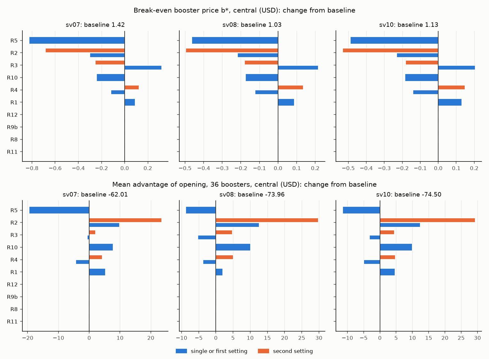

# Robustness and sensitivity (Table 4)

Generated by `scripts/robustness_report.py` from
`results/main-94de09e8-k200-m20000/robustness`
(seed 20261115, 200 epistemic draws; config
`research/experiments/main.yaml`, sha256 `94de09e83fb3…`). Test definitions
and the checks C1-C3: [ADR 0012](../../docs/decisions/0012-operational-robustness-tests.md).
Regenerate with:

```bash
uv run pokequant robustness research/experiments/main.yaml
uv run python scripts/robustness_report.py results/main-94de09e8-k200-m20000
```

Every variant uses the seed of the main run. Variants that only change card
values (R1, R2, R3, R10) are value columns of one run and are valued on the
very same simulated openings as the baseline (common random numbers). The
baseline of that run reproduces the main run
`main-94de09e8-k200-m20000`: the largest difference over every metric,
draw and scenario is 0.00e+00 USD.

Conclusions checked (central scenario):

- **C1**: opening loses on average, for every set and budget (95 % interval
  of mean Π_A below 0);
- **C2**: the break-even booster price b* is below 4.49 USD, central and
  gross, for every set (upper 95 % bound);
- **C3**: buying is decisively better on mean, median and CVaR 5 % for every
  set, every budget of 10 boosters or more and every E2 target.

## 1. Table 4: conclusions under each variant

b* is the central break-even booster price (posterior mean, USD); Δ36 is the
mean advantage of opening over buying for a 36-booster budget (mean Π_A -
Π_B, USD, central). Hypothesis columns show a status only when it differs
from the baseline (`=` otherwise).

| Variant | b* sv07 | b* sv08 | b* sv10 | Δ36 sv07 | Δ36 sv08 | Δ36 sv10 | C1 | C2 | C3 | H1 | H2 | H3 |
|---|---|---|---|---|---|---|---|---|---|---|---|---|
| baseline | 1.42 | 1.03 | 1.13 | -62.0 | -74.0 | -74.5 | yes | yes | yes | supported | supported | supported |
| R1: median of TCGplayer statistics (indicative) | 1.51 | 1.12 | 1.26 | -56.7 | -71.9 | -69.8 | yes | **no** | yes | = | = | = |
| R2: haircut 0.30 | 1.12 | 0.81 | 0.90 | -52.2 | -61.3 | -62.1 | yes | yes | yes | = | = | = |
| R2: haircut 0.50 | 0.73 | 0.54 | 0.60 | -38.5 | -44.1 | -45.2 | yes | yes | yes | = | = | = |
| R3: selling and shipping costs x0.5 | 1.74 | 1.25 | 1.34 | -62.6 | -79.2 | -77.7 | yes | yes | yes | = | = | = |
| R3: selling and shipping costs x1.5 | 1.17 | 0.85 | 0.95 | -60.0 | -69.2 | -70.0 | yes | yes | yes | = | = | = |
| R4: pull rates at lower 95 % bounds | 1.30 | 0.91 | 0.99 | -66.4 | -77.7 | -79.4 | yes | yes | yes | n/a | n/a | n/a |
| R4: pull rates at upper 95 % bounds | 1.54 | 1.17 | 1.28 | -57.8 | -68.9 | -69.7 | yes | yes | yes | n/a | n/a | n/a |
| R5: top 1 % printings excluded (E1) | 0.59 | 0.57 | 0.64 | -81.6 | -82.7 | -86.0 | yes | yes | yes | = | = | = |
| R7: 1,000 runs per draw | 1.42 | 1.03 | 1.13 | -61.9 | -74.1 | -74.6 | yes | yes | yes | = | not supported | = |
| R7: 10,000 runs per draw | 1.42 | 1.03 | 1.13 | -62.0 | -73.9 | -74.5 | yes | yes | yes | = | = | = |
| R7: 100,000 runs per draw | 1.42 | 1.03 | 1.13 | -62.0 | -73.9 | -74.5 | yes | yes | yes | = | = | = |
| R8: uniform prior | 1.42 | 1.03 | 1.13 | -62.0 | -73.9 | -74.4 | yes | yes | yes | = | = | = |
| R9b: half sample size (w = 0.5) | 1.42 | 1.03 | 1.13 | -61.9 | -73.8 | -74.4 | yes | yes | yes | = | = | = |
| R10: haircut 0.27 (Heck et al. 2026, transferred) | 1.18 | 0.86 | 0.95 | -54.2 | -63.8 | -64.5 | yes | yes | yes | = | = | = |
| R11: Dachsbun ex short print (sv07) | 1.42 | n/a | n/a | -62.0 | n/a | n/a | yes | yes | yes | = | = | = |
| R12: Hyper Rare in the rare slot | 1.42 | 1.03 | 1.13 | -61.9 | -73.9 | -74.4 | yes | yes | yes | = | = | = |

R4 rows are single models at the bounds of every hit rate (no epistemic
draws; decisive means |A - B| > 3 Monte Carlo SE). R5 runs E1 only and R11
concerns sv07 only; their hypothesis statuses are compared with the baseline
restricted to the same jobs. `n/a`: not applicable.

## 2. Where a conclusion fails

- R1: median of TCGplayer statistics (indicative), C2: sv07 gross

Summary over 17 rows (baseline included): C1 holds in 17,
C2 in 16, C3 in 17.

## 3. Break-even booster price with intervals

| Variant | sv07 central | sv08 central | sv10 central | sv07 gross | sv08 gross | sv10 gross |
|---|---|---|---|---|---|---|
| baseline | 1.42 [1.35, 1.49] | 1.03 [0.95, 1.12] | 1.13 [1.04, 1.22] | 4.29 [4.18, 4.39] | 3.44 [3.31, 3.56] | 3.78 [3.65, 3.91] |
| R1: median of TCGplayer statistics (indicative) | 1.51 [1.44, 1.59] | 1.12 [1.03, 1.21] | 1.26 [1.16, 1.36] | 4.42 [4.31, 4.53] | 3.56 [3.43, 3.69] | 3.95 [3.81, 4.10] |
| R2: haircut 0.30 | 1.12 [1.06, 1.18] | 0.81 [0.74, 0.88] | 0.90 [0.83, 0.97] | 4.29 [4.18, 4.39] | 3.44 [3.31, 3.56] | 3.78 [3.65, 3.91] |
| R2: haircut 0.50 | 0.73 [0.70, 0.77] | 0.54 [0.49, 0.59] | 0.60 [0.55, 0.65] | 4.29 [4.18, 4.39] | 3.44 [3.31, 3.56] | 3.78 [3.65, 3.91] |
| R3: selling and shipping costs x0.5 | 1.74 [1.66, 1.82] | 1.25 [1.15, 1.35] | 1.34 [1.23, 1.43] | 4.29 [4.18, 4.39] | 3.44 [3.31, 3.56] | 3.78 [3.65, 3.91] |
| R3: selling and shipping costs x1.5 | 1.17 [1.11, 1.23] | 0.85 [0.77, 0.93] | 0.95 [0.87, 1.03] | 4.29 [4.18, 4.39] | 3.44 [3.31, 3.56] | 3.78 [3.65, 3.91] |
| R4: pull rates at lower 95 % bounds | 1.30 | 0.91 | 0.99 | 4.10 | 3.24 | 3.57 |
| R4: pull rates at upper 95 % bounds | 1.54 | 1.17 | 1.28 | 4.48 | 3.65 | 4.01 |
| R5: top 1 % printings excluded (E1) | 0.59 [0.57, 0.62] | 0.57 [0.54, 0.59] | 0.64 [0.61, 0.67] | 3.14 [3.10, 3.20] | 2.80 [2.76, 2.85] | 3.11 [3.06, 3.15] |
| R8: uniform prior | 1.42 [1.35, 1.49] | 1.03 [0.95, 1.12] | 1.13 [1.04, 1.22] | 4.29 [4.19, 4.39] | 3.44 [3.31, 3.56] | 3.78 [3.65, 3.91] |
| R9b: half sample size (w = 0.5) | 1.42 [1.32, 1.52] | 1.03 [0.92, 1.16] | 1.13 [1.01, 1.26] | 4.29 [4.14, 4.44] | 3.44 [3.27, 3.62] | 3.78 [3.60, 3.97] |
| R10: haircut 0.27 (Heck et al. 2026, transferred) | 1.18 [1.12, 1.24] | 0.86 [0.78, 0.93] | 0.95 [0.87, 1.02] | 4.29 [4.18, 4.39] | 3.44 [3.31, 3.56] | 3.78 [3.65, 3.91] |
| R11: Dachsbun ex short print (sv07) | 1.42 [1.35, 1.49] | n/a | n/a | 4.29 [4.18, 4.39] | n/a | n/a |
| R12: Hyper Rare in the rare slot | 1.42 [1.34, 1.49] | 1.03 [0.95, 1.12] | 1.13 [1.03, 1.23] | 4.29 [4.18, 4.40] | 3.44 [3.32, 3.56] | 3.79 [3.64, 3.92] |

## 4. Tornado plot



Change from the baseline of the central b* (top) and of the 36-booster mean
advantage of opening (bottom). Paired tests (R2, R3, R4) show both settings:
blue is the first (h = 0.30, x0.5, lower bounds), orange the second.

## 5. R7: number of simulated runs

Posterior mean [95 % interval] over the 200 draws and median Monte Carlo
standard error within a draw, central scenario. The last column counts
the mean, median and CVaR verdicts (6 jobs x 3 metrics) that differ from
the baseline.

| Set | Runs per draw | mean Π (n=36) | MC SE | CVaR 5 % (n=36) | MC SE | P(K < a), top_sir | MC SE | Verdicts changed vs baseline |
|---|---|---|---|---|---|---|---|---|
| sv07 | 1,000 | -110.44 [-114.55, -107.02] | 1.39 | 157.37 [156.60, 158.07] | 0.40 | 0.043 [0.029, 0.057] | 0.006 | 0 of 18 |
| sv07 | 10,000 | -110.58 [-113.36, -108.03] | 0.42 | 157.32 [156.84, 157.76] | 0.12 | 0.043 [0.035, 0.052] | 0.002 | 0 of 18 |
| sv07 | 20,000 (baseline) | -110.56 [-113.33, -107.88] | 0.31 | 157.33 [156.86, 157.78] | 0.08 | 0.043 [0.036, 0.051] | 0.001 | 0 of 18 |
| sv07 | 100,000 | -110.53 [-113.12, -107.86] | 0.14 | 157.34 [156.94, 157.75] | 0.04 | 0.043 [0.036, 0.051] | 0.001 | 1 of 18 |
| sv08 | 1,000 | -124.71 [-128.25, -120.52] | 1.39 | 159.38 [158.60, 160.00] | 0.31 | 0.068 [0.048, 0.085] | 0.008 | 1 of 18 |
| sv08 | 10,000 | -124.49 [-127.59, -121.48] | 0.45 | 159.40 [158.99, 159.73] | 0.10 | 0.068 [0.055, 0.081] | 0.002 | 0 of 18 |
| sv08 | 20,000 (baseline) | -124.56 [-127.74, -121.32] | 0.32 | 159.39 [159.01, 159.71] | 0.07 | 0.068 [0.056, 0.080] | 0.002 | 0 of 18 |
| sv08 | 100,000 | -124.54 [-127.65, -121.42] | 0.14 | 159.40 [159.04, 159.72] | 0.03 | 0.067 [0.056, 0.080] | 0.001 | 0 of 18 |
| sv10 | 1,000 | -121.12 [-125.63, -116.95] | 1.58 | 160.13 [159.62, 160.62] | 0.26 | 0.077 [0.058, 0.097] | 0.008 | 1 of 18 |
| sv10 | 10,000 | -120.94 [-124.63, -117.38] | 0.50 | 160.14 [159.87, 160.42] | 0.07 | 0.076 [0.062, 0.090] | 0.003 | 0 of 18 |
| sv10 | 20,000 (baseline) | -120.97 [-124.35, -117.55] | 0.34 | 160.15 [159.90, 160.45] | 0.05 | 0.076 [0.063, 0.089] | 0.002 | 0 of 18 |
| sv10 | 100,000 | -120.94 [-124.35, -117.55] | 0.16 | 160.15 [159.90, 160.39] | 0.02 | 0.076 [0.063, 0.088] | 0.001 | 0 of 18 |

Verdicts that differ from the baseline:

- 100,000 runs, sv07 n=1 mean: decisive: A (share of draws A better 0.975) instead of undetermined (0.895).
- 1,000 runs, sv08 n=1 mean: undetermined (share of draws A better 0.105) instead of decisive: B (0.000).
- 1,000 runs, sv10 n=1 mean: undetermined (share of draws A better 0.270) instead of decisive: B (0.040).

## 6. R6 and R13

- **R6 (several sets).** The main run already compares the three sets; the
  across-set half of H4 is not supported (see results.md, §4).
- **R13 (TCGplayer-only rates).** Not run: the homogeneity rule did not reject
  pooling (ADR 0010, item 6).
