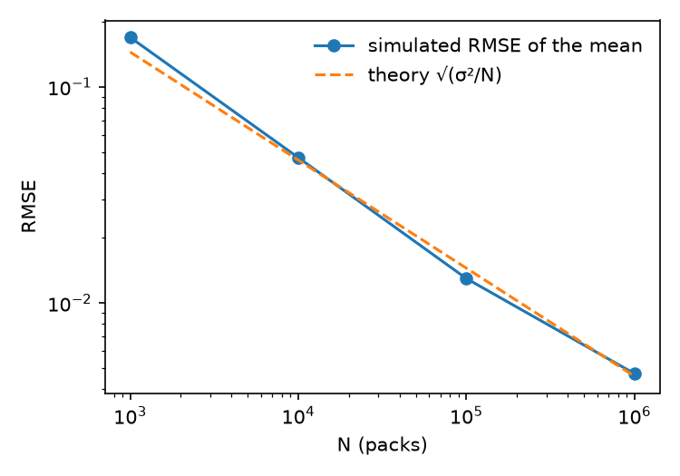

# Monte Carlo engine validation

Generated by `scripts/validate_engine.py` (pokequant 0.0.1, seed 20261115).
No price is used: card values are synthetic. Real-set checks use the
posterior-mean booster model of Surging Sparks (sv08, layout `tcgplayer`).

## 1. Toy case: one slot, two cards

Card x (value 10) with probability 0.3, card y (value 0) otherwise;
exact mean 3, exact variance 21. N = 10⁶ packs.

| | Exact | Simulated | Deviation / SE |
|---|---|---|---|
| Mean | 3 | 2.9919 | 1.76 |
| Variance | 21 | 20.9677 | — |

## 2. Simulated card frequencies vs theory (sv08)

χ² goodness of fit of the printing drawn in each random slot, N = 1,000,000 packs.

| Slot | Printings with p > 0 | χ² | d.f. | p-value |
|---|---|---|---|---|
| rev1 | 173 | 191.5 | 172 | 0.147 |
| rev2 | 205 | 196.4 | 204 | 0.636 |
| rare | 55 | 52.2 | 54 | 0.544 |

## 3. Hit counts vs binomial (sv08, one Special Illustration Rare)

Packs containing the target among 100 packs, 50,000 runs;
p_hit = 0.001119.

| | Binomial | Simulated |
|---|---|---|
| Mean | 0.1119 | 0.1122 |
| Variance | 0.1117 | 0.1118 |
| P(at least one) | 0.1059 | 0.1064 |

## 4. Monte Carlo error decay

RMSE of the toy-case mean over 50 repetitions per N;
fitted log-log slope = -0.523 (theory: -0.5).

| N | RMSE | Theory √(21/N) |
|---|---|---|
| 1,000 | 0.16951 | 0.14491 |
| 10,000 | 0.04707 | 0.04583 |
| 100,000 | 0.01298 | 0.01449 |
| 1,000,000 | 0.00471 | 0.00458 |

## 5. Aggregate (multinomial) path and assumption A-CU

Total synthetic value of 10 packs, 100,000 runs each.

| Path | Mean | Std | 5 % quantile |
|---|---|---|---|
| Card by card, with replacement | 197.872 | 30.875 | 149.797 |
| Aggregate (multinomial) | 197.889 | 30.997 | 149.519 |
| Card by card, A-CU (distinct C/U) | 198.018 | 30.559 | 150.356 |

Kolmogorov-Smirnov, card by card vs aggregate: p = 0.910.
A-CU changes the standard deviation by -1.02 %, which justifies the aggregate path.

## 6. Packs to the target (E2) and reproducibility

Cap n_max = ⌈3 / p_hit⌉ = 2682; 100,000 runs.

| | Theory | Simulated |
|---|---|---|
| E[min(K, n_max)] | 849.5 | 853.0 |
| P(no hit by n_max) | 0.0497 | 0.0502 |

Same seed, data and model ⇒ identical output: True.
